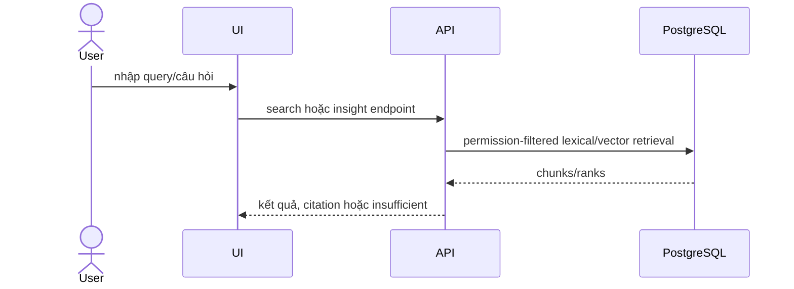

# UC-07: Tra cứu và insight có hỗ trợ AI

## 1. Thông tin tổng quan

Tác nhân là sinh viên/giảng viên đã đăng nhập; mục tiêu là tìm, hỏi, tóm tắt và khám phá tài liệu bằng evidence. Tiền điều kiện: tài liệu visible và index `ready` hoặc `empty` phù hợp.

## 2. Luồng chính

## 3. Quy tắc

Reader được đọc nhưng không retry/tag mutate; revoked không nhận citation. File rỗng single trả `400 EMPTY_FILE`, batch skipped. Citation chỉ trỏ active run; thiếu evidence phải abstain.

## 4. Dữ liệu

`documents -> document_index_runs -> document_chunks`; vector nullable và coverage/summary JSONB.

## 5. API/UI

`GET /search/full`, `/documents/{id}/index-status`, `POST .../index-retry`, `/chunks/{chunk}`, `/questions`, `/summary`, `/tag-suggestions`, `/related`, `/stats/me?days=7|30`.

## 6. Giới hạn

Basic extractive/evidence-based; DB operational gate và benchmark còn deferred. OCR chuyên biệt/advanced QA thuộc Phase 7/8.
