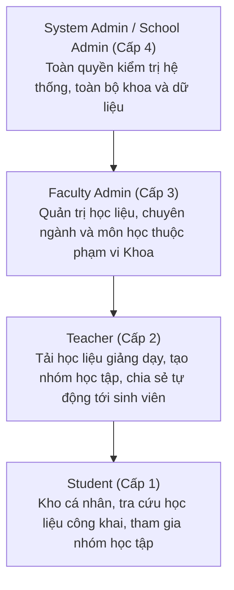
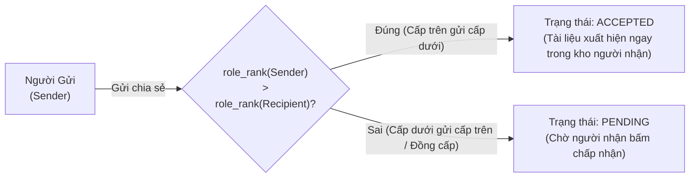

# Kiểm Soát Truy Cập & Phân Quyền (RBAC & Access Control)

Tài liệu này đặc tả chi tiết kiến trúc phân quyền dựa trên vai trò (Role-Based Access Control - RBAC), quy tắc chuẩn hóa vai trò, cơ chế cách ly theo Khoa chuyên môn và ma trận phân quyền tài nguyên trong **Foundation Project**.

---

## 1. Hệ Thống 5 Cấp Bậc Vai Trò (Role Hierarchy)

Hệ thống quản lý người dùng với 5 vai trò chính thức, được phân cấp theo thứ bậc từ 1 đến 4 (`ROLE_RANK`):



### Bảng Phân Cấp & Chuẩn Hóa Vai Trò

Được triển khai trong mã nguồn tại `backend/app/core/roles.py`:

| Tên vai trò chính thức (`role`) | Tên cũ (Legacy Alias) | Thứ bậc (`role_rank`) | Quyền hạn tiêu biểu trong hệ thống |
| :--- | :--- | :---: | :--- |
| **`system_admin`** | `sysadmin` | **4** | Quản trị kỹ thuật, xem log toàn hệ thống, cấu hình tham số, dọn dẹp dữ liệu mồ côi. |
| **`school_admin`** | `schooladmin` | **4** | Quản trị nội dung học thuật toàn trường, duyệt các môn học liên khoa, quản lý danh mục chung. |
| **`faculty_admin`** | - | **3** | Quản lý học liệu, môn học, phê duyệt bài gửi duyệt của sinh viên và giảng viên thuộc Khoa mình phụ trách. |
| **`teacher`** | - | **2** | Quản lý kho bài giảng cá nhân, chia sẻ tự động học liệu cho sinh viên, tạo nhóm học tập theo lớp. |
| **`student`** | - | **1** | Sử dụng kho tài liệu cá nhân, tra cứu thư viện chung, tham gia nhóm khi được mời, gửi bài đóng góp. |

---

## 2. Cơ Chế Cách Ly Quyền Hạn Theo Khoa (`verify_faculty_access`)

Nhằm bảo đảm tính tự chủ và an toàn dữ liệu giữa các Khoa trong trường (ví dụ: Quản trị viên Khoa Công nghệ Thông tin không thể can thiệp hoặc duyệt tài liệu thuộc Khoa Kinh tế):

```python
def verify_faculty_access(current_user: User, faculty_code: str) -> bool:
    user_role = norm_role(current_user.role)
    target_faculty_code = faculty_code.lower().strip()

    # 1. Quản trị viên cấp trường / toàn hệ thống: Toàn quyền trên mọi Khoa
    if is_global_admin(user_role):
        return True

    # 2. Quản trị viên Khoa: Thẩm định mã khoa khớp với tiền tố email
    if user_role == "faculty_admin":
        email_prefix = current_user.email.split("@")[0].lower().strip()
        if email_prefix == target_faculty_code:
            return True

    # 3. Không hợp lệ: Từ chối truy cập ngay lập tức
    raise HTTPException(
        status_code=status.HTTP_403_FORBIDDEN,
        detail=f"Tài khoản '{current_user.username}' không có quyền quản lý Khoa/Môn học '{faculty_code}'"
    )
```

---

## 3. Ma Trận Quyền Hạn Trong Không Gian Nhóm (Workspaces)

Trong phạm vi một nhóm làm việc (`workspaces`), các thành viên được gán một trong 4 cấp độ quyền hạn cụ thể:

| Cấp quyền nhóm | Xem tài liệu & tải file | Tải tài liệu lên nhóm | Sửa/Xóa tài liệu nhóm | Quản lý thành viên & Mời | Giải tán nhóm |
| :--- | :---: | :---: | :---: | :---: | :---: |
| **`owner`** (Trưởng nhóm) | ✅ | ✅ | ✅ (Toàn bộ) | ✅ | ✅ |
| **`admin`** (Phó nhóm/Quản trị) | ✅ | ✅ | ✅ (Toàn bộ) | ✅ (Trừ Owner) | ❌ |
| **`edit`** (Thành viên đóng góp) | ✅ | ✅ | ✅ (Chỉ file của mình) | ❌ | ❌ |
| **`view`** (Thành viên chỉ đọc) | ✅ | ❌ | ❌ | ❌ | ❌ |

---

## 4. Cơ Chế Chia Sẻ Tài Liệu Tự Động (Auto-Accept Sharing)

Cơ chế chia sẻ tài liệu giữa hai người dùng tuân thủ nguyên lý thứ bậc:



- **Quy tắc an toàn**: Không người dùng nào có thể tự động ép tài liệu của mình vào kho cá nhân của người có thứ bậc cao hơn mà không qua bước phê duyệt.
- **Tính năng thu hồi (Withdraw)**: Người gửi có quyền thu hồi tài liệu đã chia sẻ bất kỳ lúc nào qua lệnh `DELETE /shares/{share_id}`.
