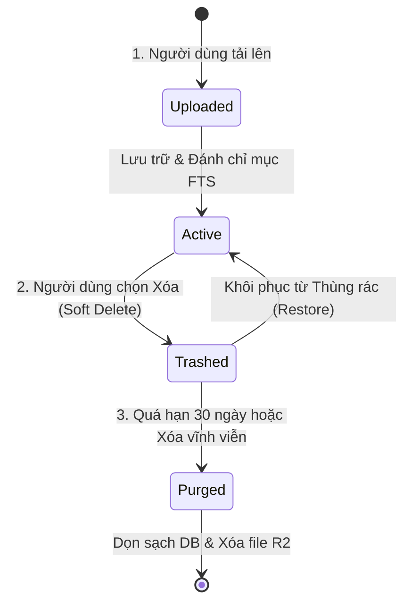

# Xử Lý Dữ Liệu & Quyền Riêng Tư (Data Handling & Privacy)

Tài liệu này xác định các cấp độ phân loại dữ liệu, cơ chế bảo vệ thông tin nhận dạng cá nhân (PII), quy trình quản lý vòng đời dữ liệu từ lúc tải lên đến khi xóa vĩnh viễn trong **Foundation Project**.

---

## 1. Phân Loại Dữ Liệu Hệ Thống (Data Classification)

| Cấp độ phân loại | Các thực thể dữ liệu tiêu biểu | Quy chế truy cập | Biện pháp bảo vệ |
| :--- | :--- | :--- | :--- |
| **Mật & Cực kỳ nhạy cảm (Confidential / Critical)** | Mật khẩu tài khoản (`hashed_password`), Khóa ký JWT, Thông tin kết nối CSDL, Cloudflare S3 Secret Keys. | Tuyệt đối chỉ đọc bởi hệ thống tại runtime; không hiển thị cho bất kỳ ai. | Băm một chiều bằng `bcrypt`; nạp qua biến môi trường; không lưu trữ thô. |
| **Riêng tư & Hạn chế (Private / Restricted)** | Tài liệu trong kho cá nhân, Ghi chú riêng tư (`notes`), Việc cần làm (`user_todos`), Tài liệu nhóm kín, Nhật ký tải (`download_logs`). | Chỉ chính chủ sở hữu tài khoản hoặc thành viên có tên trong danh sách nhóm mới được truy cập. | Kiểm tra quyền sở hữu tại backend (`owner_id`, `workspace_members`); kiểm toán truy cập tải file. |
| **Học thuật Nội bộ (Academic Internal)** | Danh mục Khoa (`faculties`), Môn học (`subjects`), Lớp học (`classes`), Hồ sơ thành viên. | Dành cho sinh viên, giảng viên và cán bộ nhà trường đã đăng nhập. | Yêu cầu xác thực Bearer token JWT; phân quyền theo Khoa chuyên môn. |
| **Công khai (Public)** | Học liệu Thư viện cộng đồng đã phê duyệt (`community_submissions`), Thông tin mô tả môn học. | Khách vãng lai và toàn thể sinh viên trong và ngoài trường. | Chỉ hiển thị tài liệu đã được duyệt (`status = 'approved'`); đệm CDN và cache header 3600s. |

---

## 2. Bảo Vệ Thông Tin Nhận Dạng Cá Nhân (PII Protection)

1. **Bảo vệ Mật khẩu**: Mật khẩu người dùng được băm ngay tại cổng đăng ký bằng thuật toán `bcrypt`. Không một quản trị viên hay kỹ sư hệ thống nào có khả năng khôi phục lại mật khẩu gốc dạng văn bản thô.
2. **Ẩn dữ liệu nhạy cảm trong API**: Các Pydantic Response Models loại bỏ hoàn toàn các trường nhạy cảm (`hashed_password`, `trash_batch_id`, v.v.) trước khi gửi dữ liệu về cho trình duyệt.
3. **Bảo mật Nhật ký Kiểm toán (`download_logs`)**:
   - Địa chỉ IP (`ip_address`) và chuỗi User-Agent chỉ được ghi nhận với mục đích kiểm toán an ninh và phát hiện hành vi tải trộm hàng loạt (Scraping).
   - Dữ liệu này được cô lập trong bảng riêng và chỉ có Quản trị viên cấp cao (`system_admin`) mới có quyền truy cập báo cáo.

---

## 3. Vòng Đời Dữ Liệu & Quyền Được Lãng Quên (Data Lifecycle)

1. **Khởi tạo & Lưu trữ**:
   - Tệp tin tải lên được phân tích mã băm SHA-256. Nếu tệp tin đã tồn tại trên hạ tầng, hệ thống chỉ tạo liên kết logic, tiết kiệm tài nguyên lưu trữ.
2. **Xóa mềm (Soft Delete) vào Thùng rác**:
   - Khi người dùng xóa tài liệu hoặc thư mục, trạng thái được cập nhật thành `is_deleted = true`, ghi nhận mốc `deleted_at` và `permanent_delete_at = deleted_at + 30 days`.
   - Tài liệu biến mất khỏi giao diện chính nhưng được giữ lại trong thùng rác để người dùng có thể tự khôi phục trong vòng 30 ngày.
3. **Dọn dẹp vĩnh viễn (Hard Purge)**:
   - Tác vụ nền định kỳ quét các bản ghi có `permanent_delete_at <= NOW()`.
   - Hệ thống kiểm tra số lượng tham chiếu của tệp tin vật lý (`file_hash`). Nếu không còn bản ghi `Document` nào khác trỏ tới file này, tệp tin nhị phân trên Cloudflare R2 / đĩa sẽ được xóa hoàn toàn.
   - Thao tác này hoàn tất nghĩa vụ tuân thủ quyền được lãng quên của người dùng.
