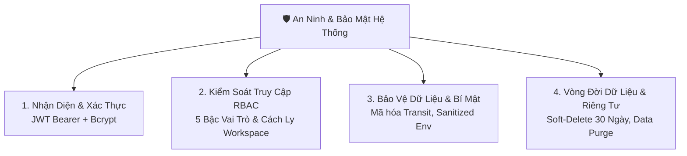

# An Toàn Thông Tin & Quyền Riêng Tư — Foundation Project

Chào mừng bạn đến với trung tâm tài liệu **An Toàn Thông Tin & Quyền Riêng Tư (Security & Privacy)** của **Foundation Project**. 

Hệ thống được thiết kế theo nguyên lý **Phòng thủ đa tầng (Defense in Depth)** và **Đặc quyền tối thiểu (Principle of Least Privilege)** nhằm bảo vệ dữ liệu học liệu, danh tính người dùng và hạ tầng lưu trữ trước các rủi ro an ninh mạng phổ biến.

---

## 1. Các Trụ Cột An Ninh Cốt Lõi

1. **Nhận diện & Xác thực (Authentication)**: Xác thực không lưu phiên (Stateless) thông qua JSON Web Token (JWT) ký bằng thuật toán an toàn HMAC SHA-256 (`HS256`). Mật khẩu người dùng được băm một chiều bằng thuật toán `bcrypt` có muối ngẫu nhiên (Salt).
2. **Kiểm soát truy cập (Authorization & RBAC)**: Phân quyền theo 5 cấp bậc nghiêm ngặt (`student`, `teacher`, `faculty_admin`, `school_admin`, `system_admin`). Cách ly dữ liệu nhiều tầng giữa Kho cá nhân, Nhóm học tập riêng tư và Thư viện cộng đồng.
3. **Quản lý khóa bí mật (Secrets Management)**: Tuyệt đối không lưu trữ thông tin xác thực, mật khẩu CSDL hoặc access keys của Cloudflare R2 trong mã nguồn Git. Mọi giá trị nhạy cảm được nạp động từ biến môi trường thông qua Pydantic `BaseSettings`.
4. **Vòng đời & Quyền riêng tư (Data Privacy)**: Cơ chế xóa mềm (Soft Delete) bảo vệ người dùng trước thao tác nhầm lẫn, kèm tác vụ định kỳ dọn dẹp vĩnh viễn (Hard delete) sau 30 ngày để tuân thủ quyền được lãng quên.

---

## 2. Bản Đồ Tài Liệu Bảo Mật

| Tài liệu | Nội dung chi tiết | Đối tượng tham chiếu |
| :--- | :--- | :--- |
| [**Tổng quan An ninh Hệ thống (Security Overview)**](./SECURITY_OVERVIEW.md) | Kiến trúc phòng thủ, mô hình hóa mối đe dọa (STRIDE) và các biện pháp bảo vệ OWASP Top 10 | Toàn bộ nhóm phát triển, Ban quản lý |
| [**Kiểm soát Truy cập & Phân quyền (Access Control)**](./AUTHORIZATION_AND_ACCESS_CONTROL.md) | Chi tiết phân cấp 5 bậc vai trò, quy tắc chia sẻ tự động, bảo vệ tài nguyên nhóm và khoa | Fullstack Devs, QA Engineers |
| [**Quản lý Khóa Bí mật & Cấu hình (Secrets & Config)**](./SECRETS_AND_CONFIGURATION.md) | Danh mục biến môi trường nhạy cảm, nguyên tắc vận hành an toàn và quy trình xoay vòng khóa | DevOps, SRE, Tech Leads |
| [**Xử lý Dữ liệu & Quyền Riêng tư (Data Handling)**](./DATA_HANDLING.md) | Vòng đời dữ liệu, xử lý dữ liệu nhạy cảm (PII), cơ chế thùng rác 30 ngày và khử trùng lặp | Data Engineers, Compliance Officers |
| [**Quy Trình Báo Cáo Lỗ Hổng (Security Reporting)**](./SECURITY_REPORTING.md) | Chính sách công bố lỗ hổng có trách nhiệm (Responsible Disclosure), SLA tiếp nhận và vá lỗi | Security Researchers, Public Users |

---

## 3. Tuân Thủ & Nguyên Tắc Bảo Mật Bắt Buộc

> [!CAUTION]
> 1. **Tuyệt đối không commit file `.env` lên Git**: Mọi khóa bí mật phải được cấu hình thông qua nền tảng hosting hoặc file `.env` cục bộ nằm trong `.gitignore`.
> 2. **Không ghi log thông tin nhạy cảm**: Không bao giờ sử dụng lệnh `print()` hoặc thư viện logging để ghi lại mật khẩu thô, token người dùng hoặc chuỗi băm mật khẩu `hashed_password`.
> 3. **Rà soát quyền hạn tại Backend**: Mọi quyết định cho phép xem/sửa/xóa tài liệu bắt buộc phải được thẩm định tại tầng FastAPI dependencies (`verify_faculty_access`, `get_current_user`), không được tin tưởng vào kiểm tra phía Frontend.
