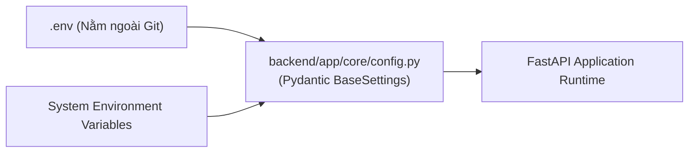

# Quản Lý Khóa Bí Mật & Cấu Hình An Toàn (Secrets & Configuration)

Tài liệu này quy định danh mục các khóa bảo mật nhạy cảm, nguyên tắc lưu trữ cấu hình an toàn, các biện pháp ngăn ngừa rò rỉ mã nguồn và quy trình xoay vòng khóa (Key Rotation) trong **Foundation Project**.

---

## 1. Danh Mục Các Khóa Bí Mật Nhạy Cảm

| Khóa bí mật (Secret Key) | Mức độ nhạy cảm | Rủi ro nếu bị lộ | Biện pháp bảo vệ |
| :--- | :---: | :--- | :--- |
| **`JWT_SECRET_KEY`** | 🔴 Nghiêm trọng | Kẻ xấu có thể tự chế tạo token JWT hợp lệ với bất kỳ quyền hạn nào (`system_admin`) để chiếm đoạt tài khoản. | Chuỗi ngẫu nhiên tối thiểu 32 ký tự; nạp từ biến môi trường; không lưu trong Git. |
| **`DATABASE_URL` / `POSTGRES_PASSWORD`** | 🔴 Nghiêm trọng | Truy cập trực tiếp vào cơ sở dữ liệu, đọc trộm hoặc xóa toàn bộ bảng dữ liệu. | Đặt trong mạng nội bộ (Internal VPC/Docker network); mật khẩu phức tạp; cô lập cổng ra internet. |
| **`R2_ACCESS_KEY_ID` & `R2_SECRET_ACCESS_KEY`** | 🔴 Nghiêm trọng | Kẻ xấu có thể tải về toàn bộ tệp tài liệu lưu trữ trên Cloudflare R2 hoặc xóa bucket. | Chỉ cấp quyền hạn tối thiểu (Read/Write trên duy nhất 1 bucket); không gán quyền xóa bucket. |
| **`ENVIRONMENT`** | 🟡 Trung bình | Chạy nhầm chế độ `development` trên production có thể lộ traceback chi tiết khi gặp lỗi. | Luôn thiết lập `ENVIRONMENT=production` trên máy chủ chính thức. |

---

## 2. Nguyên Tắc Cấu Hình An Toàn (Sanitized Configuration Pattern)

Hệ thống tuân thủ mô hình **12-Factor App** về quản lý cấu hình:



1. **Khởi tạo từ biến môi trường**: Mọi giá trị nhạy cảm được nạp động tại runtime thông qua thư viện Pydantic V2 `BaseSettings`.
2. **File mẫu chuẩn hóa (`.env.example`)**: Thư mục gốc chứa file mẫu với các giá trị giả định an toàn (`change_me_in_production`), cho phép lập trình viên sao chép và điền thông số thật mà không gây rủi ro.
3. **Loại trừ nghiêm ngặt trong Git (`.gitignore`)**:
   ```gitignore
   .env
   .env.local
   .env.production
   *.pem
   *.key
   ```

---

## 3. Quy Trình Kiểm Tra & Quét Rò Rỉ Bí Mật (Secret Leak Prevention)

Trước khi thực hiện `git push` hoặc duyệt Pull Request, nhóm phát triển khuyến nghị chạy công cụ quét tự động:

```bash
# Kiểm tra lịch sử commit không chứa các từ khóa nhạy cảm
git log -p -S "JWT_SECRET_KEY" -S "SECRET_ACCESS_KEY"

# Sử dụng công cụ chuyên dụng (Gitleaks / TruffleHog)
gitleaks detect --source . -v
```

---

## 4. Quy Trình Xoay Vòng Khóa Định Kỳ (Key Rotation Protocol)

### 4.1. Xoay Vòng Khóa Ký JWT (`JWT_SECRET_KEY`)
Khi cần xoay vòng khóa (định kỳ mỗi 6 tháng hoặc khi nghi ngờ lộ khóa):
1. Sinh chuỗi ngẫu nhiên an toàn mới:
   ```bash
   openssl rand -hex 32
   ```
2. Cập nhật giá trị mới vào biến môi trường `JWT_SECRET_KEY` trên server.
3. Khởi động lại dịch vụ backend.
4. **Hệ quả**: Toàn bộ các token cũ sẽ bị từ chối ngay lập tức; người dùng đang hoạt động sẽ nhận mã `401 Unauthorized` và chỉ cần đăng nhập lại để nhận token mới.

### 4.2. Xoay Vòng Khóa Lưu Trữ Cloudflare R2
1. Đăng nhập Cloudflare Dashboard -> R2 -> Manage R2 API Tokens.
2. Tạo mới một API Token mới với quyền `Object Read & Write` cho bucket `foundation-docs`.
3. Cập nhật `R2_ACCESS_KEY_ID` và `R2_SECRET_ACCESS_KEY` trên server.
4. Khởi động lại ứng dụng backend và thực hiện một thao tác upload/tải thử để xác nhận hoạt động bình thường.
5. Xóa API Token cũ trên Cloudflare Dashboard.
