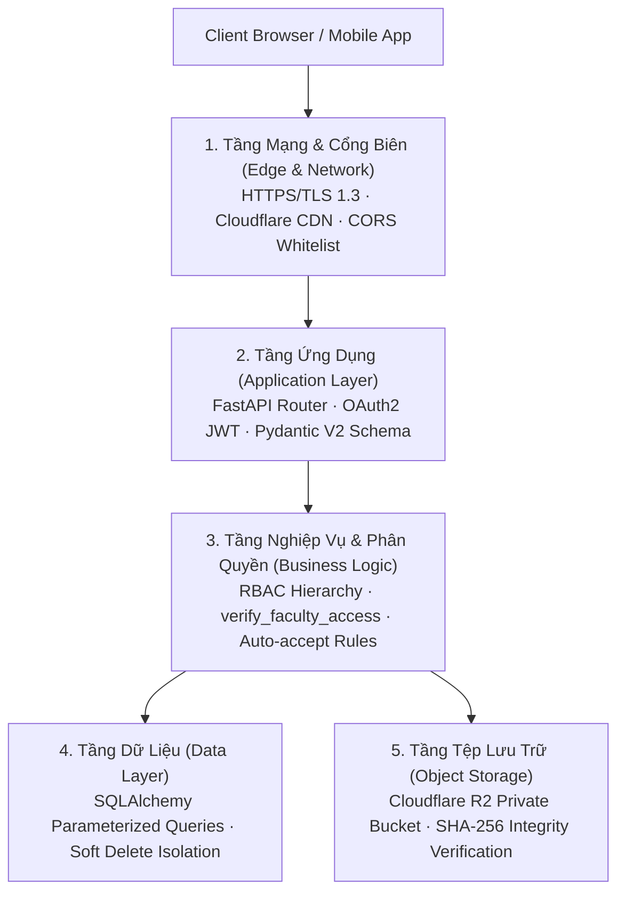

# Tổng Quan An Ninh Hệ Thống (Security Overview)

Tài liệu này phân tích các biện pháp bảo mật đa tầng được áp dụng trong **Foundation Project**, đối chiếu với các mối đe dọa an ninh mạng tiêu biểu theo chuẩn **OWASP Top 10** và mô hình hóa phòng thủ chuyên sâu.

> Xem thêm tại [Kiến Trúc An Ninh Bảo Mật](../system-architecture/SECURITY_ARCHITECTURE.md).

---

## 1. Mô Hình Phòng Thủ Đa Tầng (Defense-in-Depth)

---

## 2. Đối Chiếu Biện Pháp Phòng Thủ OWASP Top 10

| Hạng mục OWASP | Nguy cơ tiềm ẩn | Biện pháp phòng ngừa triển khai trong dự án |
| :--- | :--- | :--- |
| **A01: Broken Access Control** | Người dùng xem trộm tài liệu cá nhân của người khác hoặc chỉnh sửa tài liệu nhóm ngoài quyền. | • Xác thực quyền sở hữu (`owner_id == current_user.id`) trước mọi thao tác cập nhật/xóa. • Kiểm tra quyền thành viên nhóm (`workspace_members.role`). • Quản trị viên Khoa bị giới hạn phạm vi qua `verify_faculty_access()`. |
| **A02: Cryptographic Failures** | Lộ lọt mật khẩu tài khoản hoặc dữ liệu trên đường truyền. | • Mật khẩu người dùng được băm bằng thuật toán `bcrypt` có độ dài muối chuẩn. • Toàn bộ giao tiếp mạng bắt buộc thông qua giao thức HTTPS (TLS 1.3). • Token JWT ký bảo mật bằng thuật toán `HS256` với khóa bí mật ngẫu nhiên. |
| **A03: Injection (SQLi, Command)** | Kẻ tấn công chèn mã SQL độc hại qua form tìm kiếm hoặc query parameter. | • SQLAlchemy 2.0 sử dụng hoàn toàn truy vấn tham số hóa (Parameterized Queries), triệt tiêu SQL Injection. • Tìm kiếm FTS dùng hàm bản địa `plainto_tsquery()`, tự động khử ký tự nguy hiểm. |
| **A04: Insecure Design** | Lỗi thiết kế nghiệp vụ dẫn đến việc chia sẻ trái phép hoặc spam tài nguyên. | • Thiết kế luồng chia sẻ có điều kiện dựa trên thứ bậc vai trò (`is_auto_accept`). • Partial Unique Index `uq_document_shares_pending` ngăn chặn hoàn toàn việc gửi yêu cầu chia sẻ trùng lặp. |
| **A05: Security Misconfiguration** | Lộ thông tin nhạy cảm qua header CORS hoặc trang debug lộ mã nguồn. | • Cấu hình `CORSMiddleware` với danh sách trắng (whitelist) các origin được phép, không dùng `allow_origins=["*"]` cho các origin nhạy cảm có gửi credentials. • Chế độ Debug của FastAPI được tắt trên môi trường Production. |
| **A07: Identification Failures** | Kẻ xấu sử dụng lại token đã cũ hoặc giả mạo danh tính. | • Token JWT có thời hạn tự động hết hiệu lực sau `ACCESS_TOKEN_EXPIRE_MINUTES` (60 phút). • Mọi yêu cầu bảo vệ đều kiểm tra tính toàn vẹn của chữ ký mật mã trước khi cho phép vào router. |
| **A08: Software Integrity Failures** | Tải lên tệp tin độc hại giả mạo định dạng hoặc làm tràn ngập ổ đĩa. | • Giới hạn dung lượng tối đa 50MB cho mỗi tệp tin. • Tính toán mã băm SHA-256 để phát hiện và khử trùng lặp file (Deduplication). • Lưu trữ file với tên ngẫu nhiên (UUID), loại bỏ rủi ro Path Traversal. |
| **A09: Logging & Monitoring Failures** | Không lưu vết khi xảy ra sự cố truy cập hoặc tải trộm dữ liệu. | • Bảng `download_logs` lưu vết chi tiết mọi lượt tải file (User ID, IP, User-Agent, thời gian). • Bảng `document_activities` ghi chép lịch sử thao tác trên từng tài liệu. |

---

## 3. Kiến Trúc Cách Ly Dữ Liệu Nhiều Tầng

1. **Kho Cá Nhân (Personal Space)**:
   - Dữ liệu hoàn toàn riêng tư. Chỉ chính chủ sở hữu tài khoản (`owner_id = current_user.id`) mới có quyền xem, sửa, tải hoặc xóa tài liệu và cây thư mục.
2. **Không Gian Nhóm (Workspace Space)**:
   - Được bảo vệ theo danh sách thành viên. Người dùng ngoài nhóm không thể truy vấn hoặc tải tài liệu nhóm ngay cả khi biết chính xác ID tài liệu.
3. **Thư Viện Cộng Đồng (Community Library)**:
   - Tài liệu chỉ trở thành công khai sau khi vượt qua quy trình thẩm định nội dung và được Quản trị viên Khoa hoặc Quản trị viên Trường phê duyệt (`status = 'approved'`).
