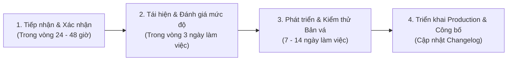

# Quy Trình Báo Cáo Lỗ Hổng Bảo Mật (Security Reporting & Disclosure)

Nhóm phát triển **Foundation Project** cam kết duy trì tính an toàn và bảo mật cao nhất cho người dùng và dữ liệu học thuật. Chúng tôi hoan nghênh và đánh giá cao sự đóng góp của cộng đồng nghiên cứu an toàn thông tin và các lập trình viên trong việc phát hiện và khắc phục các lỗ hổng bảo mật.

---

## 1. Chính Sách Công Bố Có Trách Nhiệm (Responsible Disclosure Policy)

Nếu bạn phát hiện một vấn đề bảo mật hoặc lỗ hổng trong hệ thống, chúng tôi đề nghị bạn:
1. **Thông báo riêng tư cho đội ngũ phát triển**: Tuyệt đối không công bố công khai chi tiết lỗ hổng trên mạng xã hội, diễn đàn hoặc tạo GitHub Issue công khai trước khi bản vá được phát hành.
2. **Không khai thác vượt mức cần thiết**: Dừng lại ngay sau khi có đủ bằng chứng (PoC) chứng minh sự tồn tại của lỗ hổng. Không truy cập, sửa đổi hoặc xóa dữ liệu của người dùng khác.
3. **Dành thời gian hợp lý để khắc phục**: Cho phép đội ngũ kỹ thuật có khoảng thời gian hợp lý (tối thiểu 14 ngày làm việc) để phân tích, thử nghiệm và triển khai bản vá trước khi công bố thông tin.

---

## 2. Kênh Tiếp Nhận Báo Cáo

Bạn có thể gửi báo cáo bảo mật thông qua một trong hai hình thức an toàn sau:

| Kênh liên hệ | Cách thức gửi | Mức độ ưu tiên |
| :--- | :--- | :---: |
| **GitHub Private Vulnerability Reporting** | Truy cập mục **Security** -> **Advisories** -> Bấm **Report a vulnerability** trên repository GitHub. | 🟢 Khuyến nghị cao nhất (Bảo mật 100%) |
| **Email An Ninh Trực Tiếp** | Gửi email kèm tiêu đề `[SECURITY ISSUE] Tóm tắt lỗ hổng` tới hộp thư kỹ thuật của nhóm quản trị dự án. | 🟢 Xử lý nhanh trong 24h |

---

## 3. Quy Trình & Thời Gian Xử Lý (Response SLA)

1. **Giai đoạn 1 — Tiếp nhận (24 - 48 giờ)**: Đội ngũ bảo mật gửi email xác nhận đã nhận được báo cáo và cử kỹ sư phụ trách chính.
2. **Giai đoạn 2 — Tái hiện (1 - 3 ngày làm việc)**: Kỹ sư tiến hành kiểm chứng môi trường Staging/Local, đánh giá điểm rủi ro theo chuẩn CVSS (Common Vulnerability Scoring System).
3. **Giai đoạn 3 — Khắc phục (7 - 14 ngày làm việc)**:
   - Nghiêm trọng (Critical / High): Phát hành bản vá khẩn cấp trong vòng 48 - 72 giờ.
   - Trung bình / Thấp (Medium / Low): Tích hợp vào bản phát hành sprint tiếp theo.
4. **Giai đoạn 4 — Hoàn tất & Ghi nhận**: Cập nhật bản vá lên máy chủ chính thức, thông báo cho người phát hiện và vinh danh trong danh sách đóng góp bảo mật của dự án.
