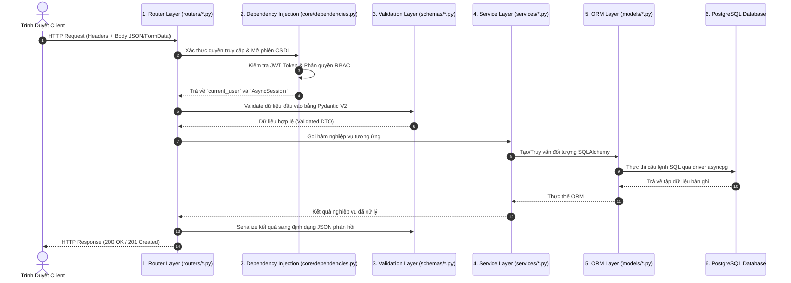
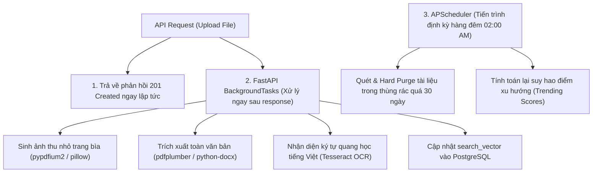

# ⚙️ Kiến Trúc Tầng Dịch Vụ Máy Chủ (Backend Architecture)

Tầng máy chủ của **Digital Library** được hiện thực hóa bằng **FastAPI** trên nền tảng **Python 3.11**, áp dụng mô hình kiến trúc phân lớp hướng dịch vụ (**Layered Service-Oriented Architecture**). Toàn bộ luồng dữ liệu I/O được xử lý hoàn toàn theo cơ chế bất đồng bộ (**Asynchronous I/O**) thông qua `async/await` và driver cơ sở dữ liệu `asyncpg`.

---

## 1. Tổ Chức Mã Nguồn Theo Phân Lớp (`backend/app/`)

```text
backend/app/
├── core/                           # Cấu hình cốt lõi & Hạ tầng dùng chung
│   ├── config.py                   # Pydantic Settings đọc biến môi trường .env
│   ├── database.py                 # AsyncEngine, sessionmaker (AsyncSession)
│   ├── security.py                 # Mã hóa mật khẩu bcrypt, tạo/giải mã JWT Token
│   └── dependencies.py             # Dependency Injection (get_db, get_current_user...)
├── models/                         # 20 Mô hình thực thể SQLAlchemy Declarative
├── schemas/                        # Lớp DTO / Serialization Pydantic V2
├── routers/                        # 22 Bộ điều phối định tuyến HTTP Endpoints
│   ├── auth.py                     # Xác thực đăng nhập, đăng ký
│   ├── documents.py                # CRUD tài liệu, upload, đổi ảnh bìa
│   ├── library.py                  # Thư viện cộng đồng, xét duyệt submission
│   ├── search.py                   # Tìm kiếm toàn văn FTS
│   ├── groups.py & workspaces.py   # Quản lý nhóm và không gian làm việc
│   ├── trash.py                    # Thao tác thùng rác, khôi phục, dọn dẹp
│   ├── stats.py & dashboard.py     # Thống kê số liệu & phân tích biểu đồ
│   └── ...                         # (tags, todos, notes, favorites, shares...)
├── services/                       # Tầng xử lý logic nghiệp vụ độc lập
│   ├── file_service.py             # Tính SHA-256, điều phối ghi R2/Local
│   ├── search_service.py           # Xây dựng câu truy vấn tsquery & ranking
│   └── dashboard_service.py        # Tổng hợp số liệu thống kê
├── jobs/                           # Lập lịch tác vụ định kỳ nền
│   └── scheduler.py                # Cấu hình APScheduler (Dọn rác 30 ngày)
└── utils/                          # Các hàm tiện ích xử lý chuỗi, MIME
```

---

## 2. Luồng Xử Lý Phân Tầng (Request Processing Lifecycle)

Mỗi yêu cầu HTTP từ phía Client đi qua các tầng xử lý với nhiệm vụ phân định ranh giới rõ ràng:



---

## 3. Cơ Chế Tiêm Phụ Thuộc (Dependency Injection System)

FastAPI sử dụng kỹ thuật Dependency Injection mạnh mẽ để đảm bảo tính an toàn và dễ kiểm thử đơn vị:
* `get_db()`: Cung cấp đối tượng `AsyncSession` cho từng request, tự động đóng phiên và hoàn trả kết nối vào Connection Pool sau khi hoàn tất.
* `get_current_user()`: Trích xuất và giải mã JWT token từ Header `Authorization: Bearer <token>`, nạp thông tin người dùng từ cơ sở dữ liệu.
* `check_admin_permission()`: Kiểm tra vai trò của người dùng hiện tại; nếu không phải là `faculty_admin` hoặc `system_admin`, lập tức ngắt luồng và trả về mã lỗi HTTP `403 Forbidden`.

---

## 4. Xử Lý Tác Vụ Nền & Lập Lịch Định Kỳ (Background & Scheduled Processing)

Backend tách biệt các tác vụ tốn thời gian ra khỏi luồng xử lý chính để không làm chậm thời gian phản hồi của người dùng:



1. **Tác vụ nền nội bộ (FastAPI BackgroundTasks):**
   * Được kích hoạt ngay sau khi upload file thành công. Tác vụ trích xuất text và OCR chạy ngầm, cập nhật trường `search_vector` vào cơ sở dữ liệu mà người dùng không phải chờ đợi trên giao diện.
2. **Lập lịch tác vụ định kỳ (APScheduler):**
   * Vận hành ngầm trong cùng tiến trình máy chủ, tự động thực hiện các công việc bảo trì hệ thống định kỳ (như dọn dẹp các tệp tin trong thùng rác đã xóa mềm quá 30 ngày).
