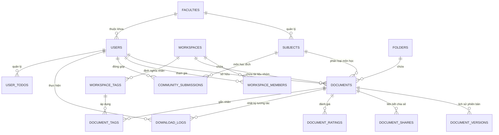

# 🗄️ Kiến Trúc Cơ Sở Dữ Liệu (Database Architecture)

Cơ sở dữ liệu của **Digital Library** được thiết kế trên hệ quản trị **PostgreSQL** (phiên bản 14 trở lên), quản lý ánh xạ quan hệ đối tượng bằng **SQLAlchemy 2.0 (Async)** và kiểm soát lịch sử cấu trúc qua **Alembic**. Lược đồ dữ liệu được chuẩn hóa ở dạng chuẩn 3NF (Third Normal Form), kết hợp tối ưu hóa tìm kiếm toàn văn thông qua chỉ mục GIN trên kiểu dữ liệu `TSVECTOR`.

---

## 1. Lược Đồ Quan Hệ Tổng Thể (Entity Relationship Overview)

Hệ thống bao gồm 20 bảng thực thể được phân thành 5 cụm dữ liệu logic:



---

## 2. Danh Mục 20 Bảng Dữ Liệu Theo Phân Cụm Chức Năng

### 2.1. Cụm Người Dùng & Cơ Cấu Đào Tạo (Identity & Academics)
1. **`users`:** Thông tin tài khoản, mật khẩu băm bcrypt, vai trò (`student`, `lecturer`, `class_monitor`, `faculty_admin`, `system_admin`), MSSV, liên kết `faculty_id`.
2. **`faculties`:** Danh mục các Khoa/Viện đào tạo trong trường đại học.
3. **`subjects`:** Danh mục các Môn học thuộc từng Khoa, phục vụ phân loại tài liệu trong Thư viện cộng đồng.
4. **`academic_classes`:** Danh sách các lớp sinh hoạt và lớp học phần thực tế.

### 2.2. Cụm Không Gian Làm Việc (Workspaces & Collaboration)
5. **`workspaces`:** Thông tin không gian làm việc (`type = 'group'`).
6. **`workspace_members`:** Quan hệ thành viên trong nhóm, phân định vai trò Trưởng nhóm (`owner`) hoặc Thành viên (`member`).
7. **`workspace_invitations`:** Lời mời tham gia nhóm học tập qua username hoặc liên kết mời.

### 2.3. Cụm Tài Liệu & Cấu Trúc Lưu Trữ (Documents & Content)
8. **`documents`:** Bảng thực thể trung tâm lưu trữ toàn bộ metadata tài liệu, đường dẫn file vật lý (`file_path`), ảnh bìa (`thumbnail_path`), mã băm SHA-256 (`file_hash`), kích thước, ngữ cảnh (`workspace_context`), trạng thái công khai (`is_public`), trạng thái xóa mềm (`is_deleted`), và trường chỉ mục `search_vector`.
9. **`document_versions`:** Lưu vết lịch sử các phiên bản cũ của tài liệu khi người dùng cập nhật nội dung.
10. **`folders`:** Cây thư mục phân cấp phục vụ sắp xếp tài liệu trong kho cá nhân hoặc nhóm.
11. **`categories`:** Danh mục thể loại học liệu (Giáo trình, Đề thi, Slide, Bài tập lớn).

### 2.4. Cụm Phân Loại & Nhãn Linh Hoạt (Tags & Classifications)
12. **`tags` & `workspace_tags`:** Hệ thống thẻ nhãn do người dùng định nghĩa theo từng không gian làm việc.
13. **`document_tags`:** Bảng liên kết nhiều-nhiều (Many-to-Many) giữa `documents` và `tags`.
14. **`folder_tags`:** Bảng liên kết gắn nhãn cho thư mục.

### 2.5. Cụm Tương Tác, Đóng Góp & Vòng Đời (Interactions & Lifecycle)
15. **`community_submissions`:** Quản lý quy trình đóng góp học liệu lên Kho cộng đồng (trạng thái `pending`, `approved`, `rejected` kèm lý do từ chối).
16. **`document_shares`:** Quản lý các liên kết chia sẻ công khai bảo mật có token ngẫu nhiên và thời hạn hết hạn.
17. **`document_ratings`:** Lưu trữ đánh giá điểm số 1-5 sao và nhận xét của sinh viên cho tài liệu cộng đồng.
18. **`favorites`:** Danh sách tài liệu được người dùng đánh dấu yêu thích để tra cứu nhanh.
19. **`download_logs`:** Bảng nhật ký append-only ghi nhận toàn bộ biến cố xem, tải, lưu, thích phục vụ thống kê và tính điểm xu hướng `trending_score`.
20. **`user_todos`:** Danh sách việc cần làm cá nhân gắn với tài liệu học tập.

---

## 3. Kiến Trúc Tìm Kiếm Toàn Văn (Full-Text Search Engine)

Thay vì phải duy trì một cụm Elasticsearch hoặc Meilisearch phức tạp và tốn kém RAM, hệ thống khai thác triệt để sức mạnh tìm kiếm toàn văn tích hợp sẵn của **PostgreSQL**:

```sql
-- Cấu trúc cột chỉ mục tìm kiếm toàn văn trong bảng documents
ALTER TABLE documents ADD COLUMN search_vector tsvector;

-- Chỉ mục Generalized Inverted Index (GIN) tăng tốc tìm kiếm
CREATE INDEX ix_documents_search_vector ON documents USING gin(search_vector);

-- Cơ chế tạo tsvector từ tiêu đề (Trọng số A), mô tả (Trọng số B) và nội dung trích xuất (Trọng số C)
UPDATE documents SET search_vector = 
    setweight(to_tsvector('simple', coalesce(title, '')), 'A') ||
    setweight(to_tsvector('simple', coalesce(description, '')), 'B') ||
    setweight(to_tsvector('simple', coalesce(extracted_text, '')), 'C');
```

* **Ưu điểm:** Độ trễ tìm kiếm dưới **50ms** trên hàng chục ngàn tài liệu; hoàn toàn không có độ trễ đồng bộ (Zero Sync Lag) như khi sử dụng máy chủ tìm kiếm độc lập.

---

## 4. Chiến Lược Lập Chỉ Mục Tối Ưu (Index Optimization)

Để đảm bảo hiệu năng truy vấn cao nhất khi hệ thống tăng trưởng về số lượng bản ghi:
* `ix_documents_file_hash`: Chỉ mục B-Tree trên mã băm SHA-256, giúp kiểm tra trùng lặp tệp tin với độ phức tạp $O(1)$.
* `ix_documents_user_id_deleted`: Chỉ mục phức hợp (Compound Index) trên `(user_id, is_deleted)` tối ưu hóa việc nạp danh sách tài liệu cá nhân đang hoạt động.
* `ix_download_logs_document_created`: Chỉ mục trên `(document_id, created_at DESC)` tăng tốc độ tổng hợp báo cáo tương tác và tính điểm trending.
