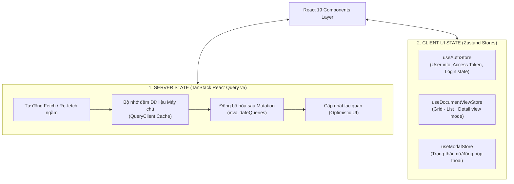
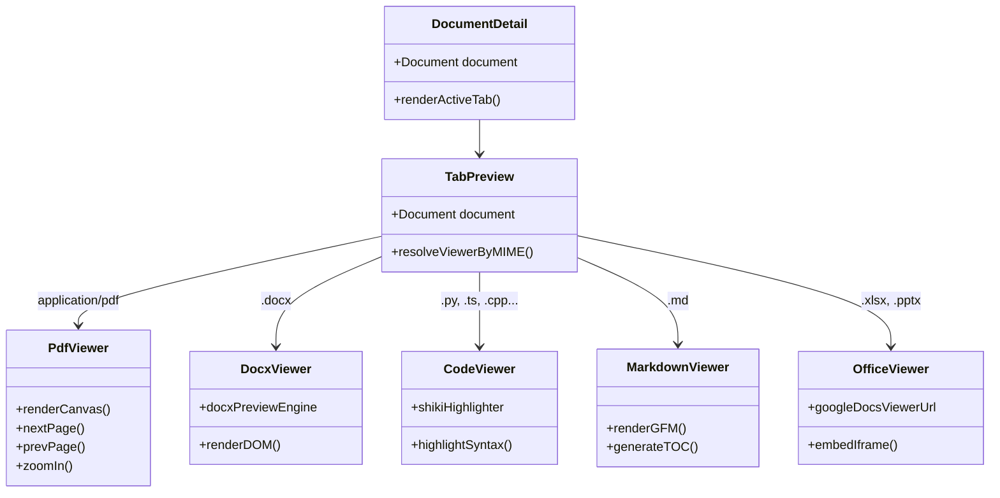
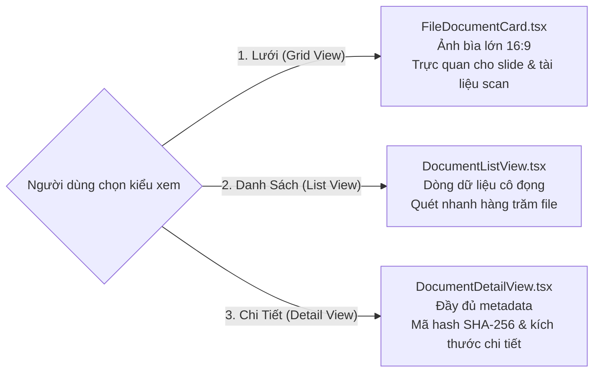

# 🎨 Kiến Trúc Tầng Giao Diện Khách Hàng (Frontend Architecture)

Ứng dụng giao diện người dùng **Digital Library Client** được xây dựng dưới dạng ứng dụng đơn trang hiện đại (**Single Page Application - SPA**) trên nền tảng **React 19**, **TypeScript** và **Vite**. Kiến trúc này chú trọng tối đa vào tốc độ phản hồi, khả năng tái sử dụng linh kiện (Component Reusability) và kỹ thuật kết xuất trực tiếp tệp tin tại trình duyệt.

---

## 1. Cấu Trúc Cây Thư Mục Mã Nguồn (`frontend/digital-library/src/`)

```text
src/
├── assets/                         # Hình ảnh tĩnh, biểu tượng và phông chữ
├── components/                     # Hệ thống linh kiện giao diện (Component Hierarchy)
│   ├── shared/                     # Linh kiện dùng chung trên toàn hệ thống
│   │   ├── documents/              # Linh kiện tài liệu (DocumentCard, DocumentListView...)
│   │   │   └── DocumentDetail/     # Màn hình chi tiết tài liệu chuyên sâu
│   │   │       ├── components/     # DocumentCoverSelector, Header, Metadata Panel
│   │   │       ├── tabs/           # TabPreview, TabActivity, TabNotes, TabVersions
│   │   │       └── viewers/        # 5 Bộ đọc tài liệu chuyên dụng (Pdf, Docx, Code, MD, Office)
│   │   └── ui/                     # Bộ linh kiện cơ sở Atomic UI (Button, Dialog, Dropdown, Input...)
├── hooks/                          # Custom React Hooks (useDocuments, useAuth, useDebounce...)
├── layouts/                        # Khung giao diện dùng chung (MainLayout, AuthLayout, Sidebar, Navbar)
├── pages/                          # 10 Phân hệ màn hình chức năng chính
│   ├── auth/                       # Đăng nhập, Đăng ký (/login, /register)
│   ├── personal/                   # Kho cá nhân (/personal/documents, /personal/trash...)
│   ├── group/                      # Không gian nhóm làm việc (/groups, /groups/:id)
│   ├── class/                      # Không gian lớp học phần (/classes)
│   ├── faculty/                    # Màn hình quản lý tài liệu cấp Khoa (/faculties)
│   ├── school/                     # Màn hình tổng quan trường học
│   ├── library/                    # Kho học liệu cộng đồng toàn trường (/library)
│   ├── search/                     # Trang tìm kiếm toàn văn nâng cao (/search)
│   ├── stats/                      # Trang thống kê biểu đồ 30 ngày (/stats)
│   └── settings/                   # Cài đặt tài khoản & đổi mật khẩu (/settings)
├── services/                       # Tầng giao tiếp mạng (API Client Axios Functions)
├── stores/                         # Quản lý trạng thái cục bộ ứng dụng qua Zustand
├── types/                          # Định nghĩa giao diện kiểu dữ liệu TypeScript
└── utils/                          # Hàm tiện ích (cn.ts, formatters.ts, mimeUtils.ts)
```

---

## 2. Mô Hình Quản Trị Trạng Thái Kép (Dual-State Strategy)

Frontend phân tách triệt để giữa **Trạng thái Dữ liệu Máy chủ (Server State)** và **Trạng thái Giao diện Cục bộ (Client State)**:



1. **Server State (TanStack React Query v5):**
   * Đảm nhiệm việc tải danh sách tài liệu, thông tin cá nhân, kết quả tìm kiếm và dữ liệu thống kê.
   * Cung cấp cơ chế lưu đệm thông minh (`staleTime: 5 * 60 * 1000`), tự động tải lại ngầm khi người dùng quay lại tab trình duyệt, và cập nhật giao diện tức thì (Optimistic Updates) khi xóa mềm hoặc gắn nhãn.
2. **Client UI State (Zustand Stores):**
   * `useAuthStore`: Quản lý phiên đăng nhập của người dùng, lưu trữ token, thông tin vai trò (`role`) và quyền hạn.
   * `useDocumentViewStore`: Ghi nhớ chế độ hiển thị ưa thích của người dùng (`grid`, `list`, hoặc `detail`) vào bộ nhớ `localStorage`.

---

## 3. Kiến Trúc Bộ Đọc Tài Liệu Chuyên Dụng (Viewers Architecture)

Điểm nhấn kỹ thuật nổi bật nhất của tầng giao diện là khả năng dựng hình tài liệu trực tiếp tại trình duyệt mà không cần cài đặt phần mềm bên ngoài:



1. **`PdfViewer.tsx`:** Dựng hình từng trang PDF bằng Canvas HTML5, hỗ trợ zoom tỷ lệ 50% - 200%, nhảy trang nhanh và chế độ toàn màn hình.
2. **`DocxViewer.tsx`:** Sử dụng thư viện `docx-preview` phân tích gói nén OpenXML của tệp Word và ánh xạ trực tiếp sang cây DOM HTML, giữ nguyên định dạng bảng biểu và chữ đậm/nghiêng.
3. **`CodeViewer.tsx`:** Tích hợp bộ tô màu cú pháp `shiki` với chuẩn TextMate Grammars, hiển thị số dòng (line numbers) và giao diện tối tương tự VS Code.
4. **`MarkdownViewer.tsx`:** Phân tích tài liệu Markdown (`react-markdown` + `remark-gfm`), tự động sinh cây mục lục bên cạnh để người đọc dễ điều hướng bài học dài.
5. **`OfficeViewer.tsx`:** Nhúng trình xem công khai của Google Docs hoặc Microsoft Office Online thông qua iframe cho các tệp Excel (`.xlsx`) và PowerPoint (`.pptx`).

---

## 4. Hệ Thống 3 Chế Độ Hiển Thị Đa Phong Cách (Multi-View Modes)

Hệ thống cho phép người dùng chuyển đổi linh hoạt giữa 3 góc nhìn:



* **Ma trận màu nhận diện định dạng (MIME Color System):**
  * Đỏ (`#EF4444`): Tệp tin PDF.
  * Xanh dương (`#3B82F6`): Tệp tin Word (`.docx`).
  * Xanh lá (`#10B981`): Tệp tin Excel (`.xlsx`).
  * Cam (`#F97316`): Tệp tin PowerPoint (`.pptx`).
  * Tím (`#8B5CF6`): Mã nguồn lập trình (`Code`).
  * Xám/Vàng: Văn bản thuần túy và Markdown.
