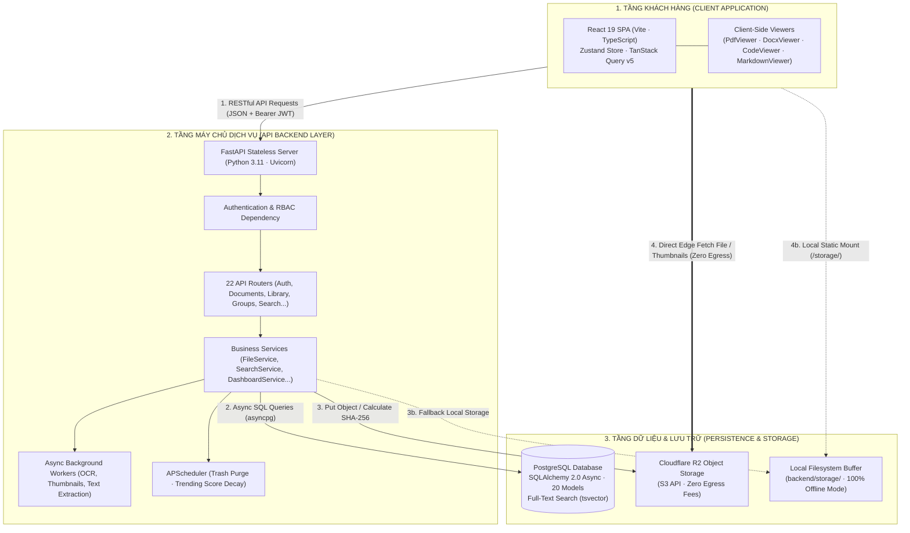
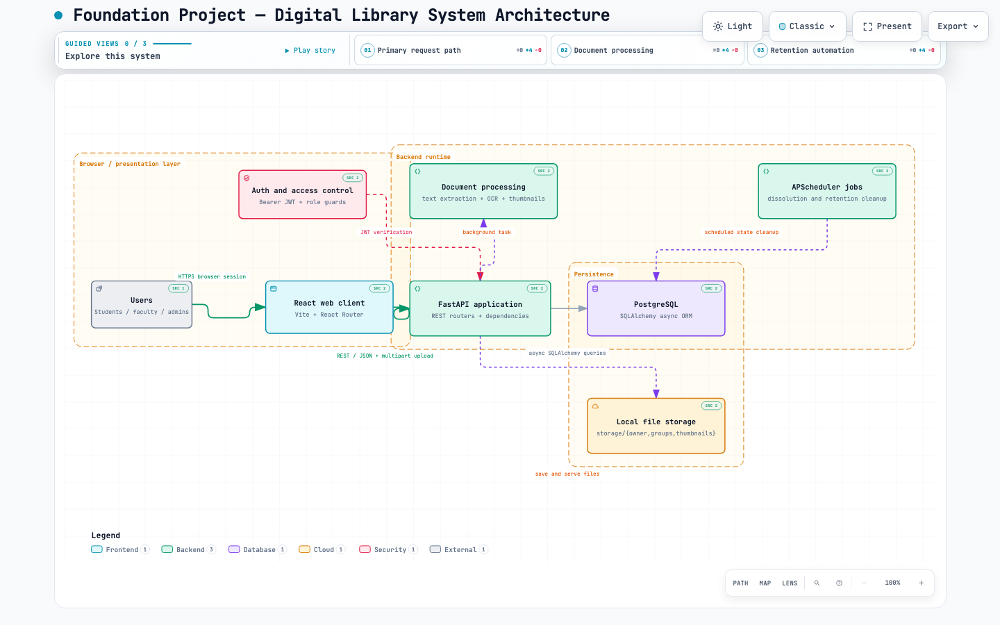
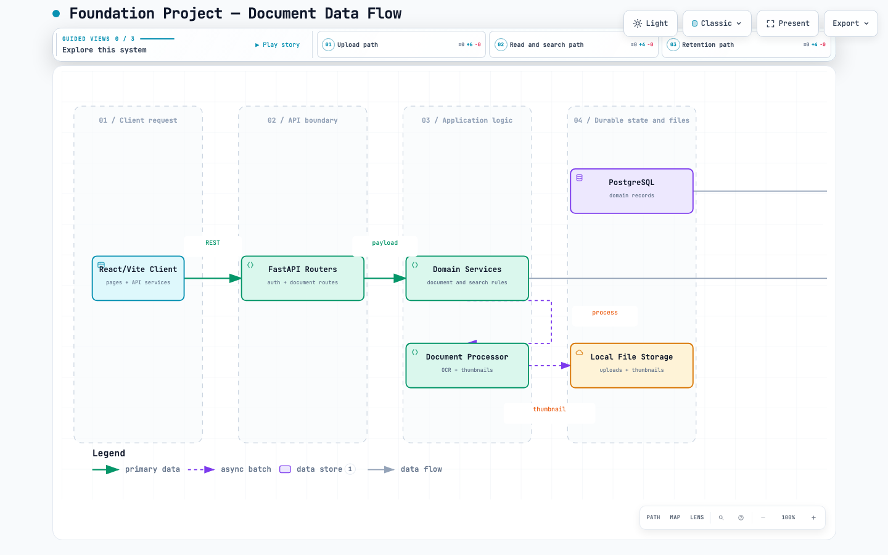

# 🏗️ Tổng Quan Kiến Trúc Hệ Thống (System Architecture)

Hệ thống **Thư Viện Số (Digital Library)** được thiết kế theo mô hình kiến trúc phân lớp hiện đại (**Modern Layered Architecture**), kết hợp giữa kiến trúc lưu trữ đám mây lai (**Hybrid Cloud Storage**) và cơ chế tải trực tiếp từ biên (**Client Edge Fetching**). Thiết kế này đáp ứng đồng thời hai mục tiêu: tối ưu hóa trải nghiệm người dùng với độ trễ siêu thấp và triệt tiêu 100% chi phí băng thông truyền tải dữ liệu (Zero Egress Fees).

---

## 🗺️ Bản Đồ Kiến Trúc Tổng Thể

---

## 🖼️ Sơ Đồ Trực Quan Hệ Thống

### 1. Sơ Đồ Kiến Trúc Hệ Thống (System Architecture Diagram)
> Mô tả tương tác giữa các phân hệ Client, Backend và các nút lưu trữ Hybrid:

---

### 2. Sơ Đồ Luồng Xử Lý Dữ Liệu (Data Flow Diagram)
> Mô tả luồng dữ liệu từ khi người dùng tải tệp lên, trích xuất text/OCR ngầm, cho tới khi hiển thị tìm kiếm và xem trước:

---

## 📚 Danh Mục Tài Liệu Chuyên Sâu Trong Phân Hệ Kiến Trúc

1. **[Mô Hình Kiến Trúc C4 & Tổng Quan (SYSTEM_OVERVIEW.md)](./SYSTEM_OVERVIEW.md):** Bản thiết kế theo chuẩn C4 Model (Context, Container, Component).
2. **[Ngăn Xếp Công Nghệ Chuẩn Hóa (TECHNOLOGY_STACK.md)](./TECHNOLOGY_STACK.md):** Danh mục toàn bộ phiên bản thư viện, lý do lựa chọn và đánh đổi kỹ thuật.
3. **[Kiến Trúc Tầng Giao Diện (FRONTEND_ARCHITECTURE.md)](./FRONTEND_ARCHITECTURE.md):** Cấu trúc React 19, giải pháp quản trị trạng thái (Zustand + TanStack Query), và cơ chế Viewers.
4. **[Kiến Trúc Tầng Dịch Vụ Máy Chủ (BACKEND_ARCHITECTURE.md)](./BACKEND_ARCHITECTURE.md):** Phân tích mô hình phân tầng Router - Service - Model của FastAPI, Dependency Injection và Async Loop.
5. **[Kiến Trúc Cơ Sở Dữ Liệu (DATABASE_ARCHITECTURE.md)](./DATABASE_ARCHITECTURE.md):** Lược đồ 20 bảng quan hệ, SQLAlchemy 2.0 Async, Alembic migrations và PostgreSQL Full-Text Search.
6. **[Kiến Trúc Lưu Trữ Bền Vững (STORAGE_ARCHITECTURE.md)](./STORAGE_ARCHITECTURE.md):** Tổng hợp cơ chế Hybrid R2/Local, mã băm SHA-256, và liên kết tới chuyên đề [Kiến Trúc Lưu Trữ Chuyên Sâu (STORAGE_SYSTEM.md)](../architecture/STORAGE_SYSTEM.md).
7. **[Kiến Trúc An Ninh & Bảo Mật (SECURITY_ARCHITECTURE.md)](./SECURITY_ARCHITECTURE.md):** Mô hình an ninh 3 lớp: JWT Authentication, Role Enforcement (RBAC), và Row-Level Authorization.
8. **[Hồ Sơ Quyết Định Kiến Trúc (Architecture Decision Records - ADR)](./adr/README.md):** 5 bản ghi quyết định kỹ thuật then chốt đã định hình nên sản phẩm.
