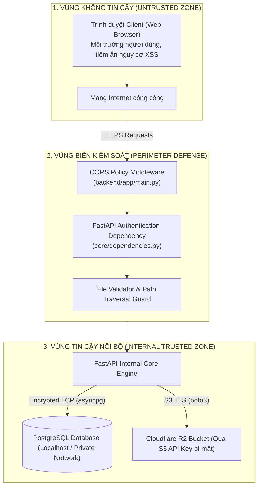
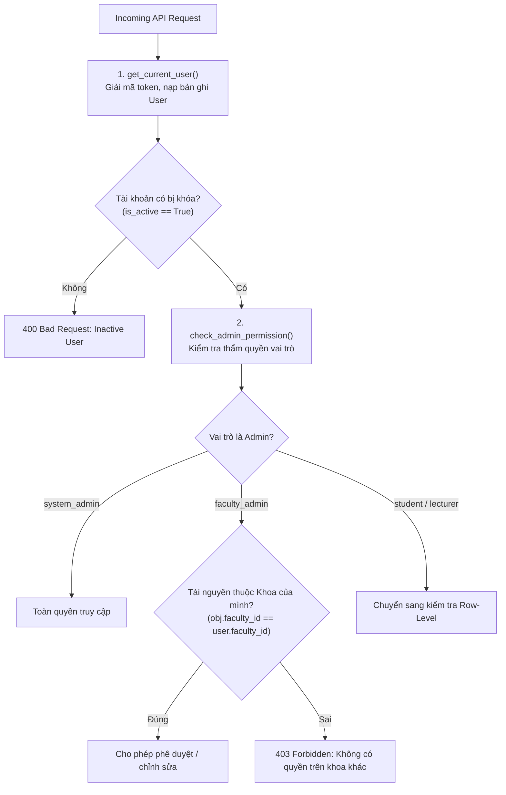

# 🛡️ Kiến Trúc An Ninh & Bảo Mật (Security Architecture)

Tài liệu này phân tích kiến trúc an ninh thông tin, các ranh giới tin cậy (**Trust Boundaries**) và cơ chế kiểm soát truy cập đa lớp của **Digital Library Platform**, dựa trên bằng chứng kiểm tra trực tiếp từ mã nguồn thực tế.

---

## 1. Mô Hình Ranh Giới Tin Cậy (Trust Boundaries)

Kiến trúc an ninh của hệ thống được tổ chức thành 3 vùng tin cậy với các rào chắn kiểm soát nghiêm ngặt:



---

## 2. Cơ Chế Xác Thực & Quản Lý Phiên (Authentication & Token Lifecycle)

### 2.1. Mã Hóa Mật Khẩu (Password Hashing)
* **Thuật toán:** Sử dụng hàm băm mật mã học **`bcrypt`** với hệ số chi phí (work factor) tiêu chuẩn thông qua thư viện `passlib`.
* **Cơ chế Salt:** Mật khẩu được tự động sinh chuỗi Salt ngẫu nhiên riêng biệt cho từng người dùng, ngăn chặn triệt để kỹ thuật tấn công bằng bảng cầu vồng (Rainbow Table).

### 2.2. Phiên Làm Việc Qua JWT (JSON Web Token)
* **Chuẩn áp dụng:** **RFC 7519 (JWT Bearer Token)** ký bằng thuật toán `HS256`.
* **Cấu trúc Payload Token:**
  ```json
  {
    "sub": "nguyen",
    "user_id": 12,
    "role": "student",
    "faculty_id": 3,
    "exp": 1731678000
  }
  ```
* **Bảo vệ Secret Key:** Khóa bí mật `SECRET_KEY` được đọc từ biến môi trường của hệ thống, không lưu cứng (hardcoded) trong mã nguồn.

---

## 3. Ma Trận Kiểm Soát Truy Cập Dựa Trên Vai Trò (RBAC Enforcement)

FastAPI thực thi phân quyền khai báo (Declarative Authorization) thông qua cơ chế Dependency Injection:



---

## 4. Bảo Mật Cấp Bản Ghi (Row-Level Authorization & IDOR Defense)

Để phòng chống lỗ hổng **Insecure Direct Object References (IDOR)** — tình huống kẻ tấn công cố tình thay đổi `document_id` trên đường dẫn URL để xem tài liệu của người khác:
* **Nguyên tắc bất biến:** Backend không bao giờ tin cậy `document_id` đơn lẻ.
* **Mã nguồn thực thi:** Mọi thao tác truy vấn tài liệu cá nhân đều bắt buộc phải kèm theo ràng buộc quyền sở hữu:
  ```python
  stmt = select(Document).where(
      Document.id == document_id,
      Document.user_id == current_user.id,
      Document.is_deleted == False
  )
  ```
* **Kho cá nhân:** Người dùng B không thể nào xem hoặc thao tác tài liệu của Người dùng A, kể cả khi đoán đúng số ID.

---

## 5. An Toàn Tệp Tin Tải Lên (File Upload Hardening)

1. **Chống Tấn Công Xuyên Thư Mục (Path Traversal Protection):**
   * Tên tệp tin gốc của người dùng được tách bỏ mọi ký tự điều hướng (`/`, `\`, `..`).
   * Tên file lưu trữ vật lý trên đĩa cứng luôn được sinh mới bằng UUID ngẫu nhiên: `{uuid4}_{sanitized_name}`.
2. **Kiểm Soát Định Dạng Chặt Chẽ (MIME Whitelisting):**
   * Chỉ chấp nhận các định dạng tệp học tập hợp lệ; cấm tuyệt đối các định dạng có khả năng thực thi mã độc trên máy chủ (`.exe`, `.sh`, `.php`, `.py`, `.bat`).
3. **Phòng Ngừa XSS Khi Xem Trước (DOM Sanitization):**
   * Toàn bộ mã nguồn Markdown và nội dung trích xuất văn bản từ DOCX/PDF trước khi chuyển thành HTML để render đều được lọc sạch các thẻ nguy hiểm (`<script>`, `<iframe>`, sự kiện `onerror`, `onload`).

---

## 6. Đánh Giá Hiện Trạng & Khuyến Nghị Nâng Cấp (Security Gap Analysis)

| Rủi ro phát hiện | Hiện trạng mã nguồn | Mức độ | Khuyến nghị nâng cấp bảo mật |
|---|---|:---:|---|
| **Lưu trữ Token tại Client** | Lưu Access Token trong `localStorage` | **Medium** | Chuyển sang cơ chế lưu trữ bằng **`HttpOnly, Secure Cookie`** để trình duyệt tự động chặn đứng nguy cơ token bị đánh cắp nếu xảy ra lỗi XSS. |
| **Xác thực Đa Yếu Tố (MFA)** | Chỉ hỗ trợ xác thực Mật khẩu đơn cấp | **Low** | Bổ sung xác thực OTP qua Email hoặc Google Authenticator cho các tài khoản quản trị viên (`faculty_admin`, `system_admin`). |
| **Giới hạn Tần suất (Rate Limiting)** | Chưa có middleware giới hạn số lượt gọi API | **Medium** | Tích hợp thư viện `slowapi` để giới hạn 100 requests/phút/IP, ngăn chặn tấn công từ chối dịch vụ (DoS) hoặc brute-force mật khẩu. |
