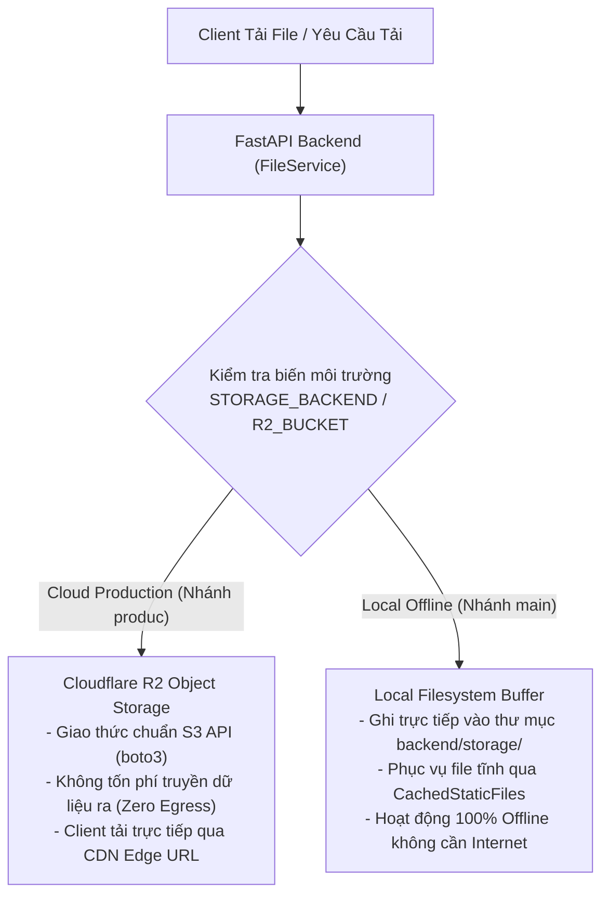
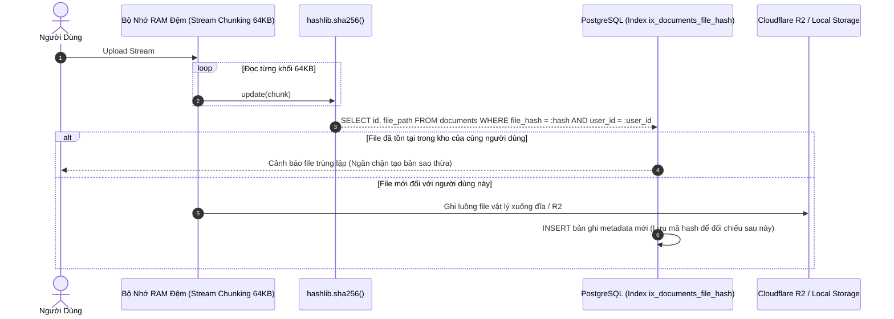

# 📦 Kiến Trúc Lưu Trữ Bền Vững (Storage Architecture)

Tài liệu này tổng hợp ở mức kiến trúc tổng thể về cơ chế lưu trữ tệp tin nhị phân, thuật toán kiểm tra trùng lặp (Deduplication) và vòng đời dữ liệu của **Digital Library Platform**. 

> 📚 **Tài liệu chuyên đề chuyên sâu:**  
> Toàn bộ cơ sở lý luận toán học về mã băm SHA-256, mô hình ước lượng RAM, mã nguồn giải phẫu từng hàm nghiệp vụ và **bộ 25 câu hỏi phản biện bảo vệ đồ án** được lưu trữ chi tiết tại:  
> 👉 **[Chuyên Đề Kiến Trúc Hệ Thống Lưu Trữ File (STORAGE_SYSTEM.md)](../architecture/STORAGE_SYSTEM.md)**.

---

## 1. Mô Hình Lưu Trữ Lai Đột Phá (Hybrid Storage Architecture)

Hệ thống được thiết kế với cơ chế trừu tượng hóa tầng lưu trữ (**Storage Abstraction Layer**), cho phép chuyển đổi liền mạch giữa hai môi trường vận hành:

### So Sánh Hai Chiến Lược Vận Hành

| Tiêu chí kỹ thuật | Chế độ Đám Mây (Cloud Production) | Chế độ Cục Bộ (Local Development) |
|---|---|---|
| **Hạ tầng lưu trữ** | Cloudflare R2 Bucket (`elibrary-bucket`) | Ổ cứng máy tính cá nhân (`backend/storage/`) |
| **Giao thức điều phối** | Amazon S3 SDK (`boto3`) | I/O tệp tin bất đồng bộ Python (`aiofiles`) |
| **Chi phí truyền tải mạng** | **0 VNĐ (Zero Egress Fees)** | **0 VNĐ (Truy xuất nội bộ)** |
| **Yêu cầu kết nối mạng** | Cần Internet để gọi S3 API & CDN | **Hoàn toàn ngoại tuyến (100% Offline)** |
| **Độ trễ tải tài liệu** | 50ms - 150ms qua mạng CDN | < 5ms (Đọc trực tiếp từ NVMe/SSD cục bộ) |
| **Mục đích sử dụng** | Triển khai thực tế cho toàn trường | Lập trình, kiểm thử và bảo vệ đồ án tốt nghiệp |

---

## 2. Kiểm Tra Trùng Lặp Theo Mã Băm SHA-256 (Deduplication Architecture)

Thay vì chỉ dựa vào tên file (dễ bị đổi) hoặc kích thước tệp tin (dễ trùng ngẫu nhiên), hệ thống sử dụng thuật toán mật mã học **SHA-256** để nhận diện bản chất nhị phân của tệp:

### Ưu điểm của mô hình Stream Chunking 64KB:
* **Không làm tràn bộ nhớ (OOM Safe):** Máy chủ chỉ tiêu thụ một lượng RAM cố định (~64KB) cho mỗi luồng tải lên, cho phép hệ thống tiếp nhận hàng chục file dung lượng 50MB cùng một lúc mà không bao giờ vượt quá ngưỡng bộ nhớ cho phép.

---

## 3. Tính Toàn Vẹn Dữ Liệu & Cơ Chế Bù Trừ (Compensating Actions)

Do hệ thống lưu trữ vật lý (R2 / Filesystem) và cơ sở dữ liệu quan hệ (PostgreSQL) là hai hệ thống độc lập, không thể sử dụng giao tác phân tán 2PC truyền thống:
* **Cơ chế phòng ngừa:** Backend luôn ghi file vật lý lên Storage trước khi commit giao tác CSDL.
* **Cơ chế bù trừ:** Nếu câu lệnh `INSERT` vào bảng `documents` bị lỗi hoặc rollback, khối `try...finally` của Service lập tức kích hoạt hàm xóa tệp vật lý vừa tải lên để bảo đảm không tồn tại file rác mồ côi chiếm dụng dung lượng đĩa.

---

## 4. Quản Lý Vòng Đời Tệp Tin (Soft Delete, Restore & Retention)

1. **Xóa mềm (Soft Delete):** Đặt cờ `is_deleted = True`, file vật lý vẫn tồn tại nguyên vẹn trong 30 ngày để người dùng có thể khôi phục lại bất kỳ lúc nào.
2. **Khôi phục (Restore):** Đặt lại `is_deleted = False`, đưa tài liệu trở lại danh sách hoạt động.
3. **Quét dọn tự động (Automatic Purge):** Tác vụ nền hàng đêm của `APScheduler` tự động xóa vĩnh viễn cả bản ghi CSDL và file nhị phân trên R2/Local đối với các tệp tin nằm trong thùng rác quá **30 ngày**.
