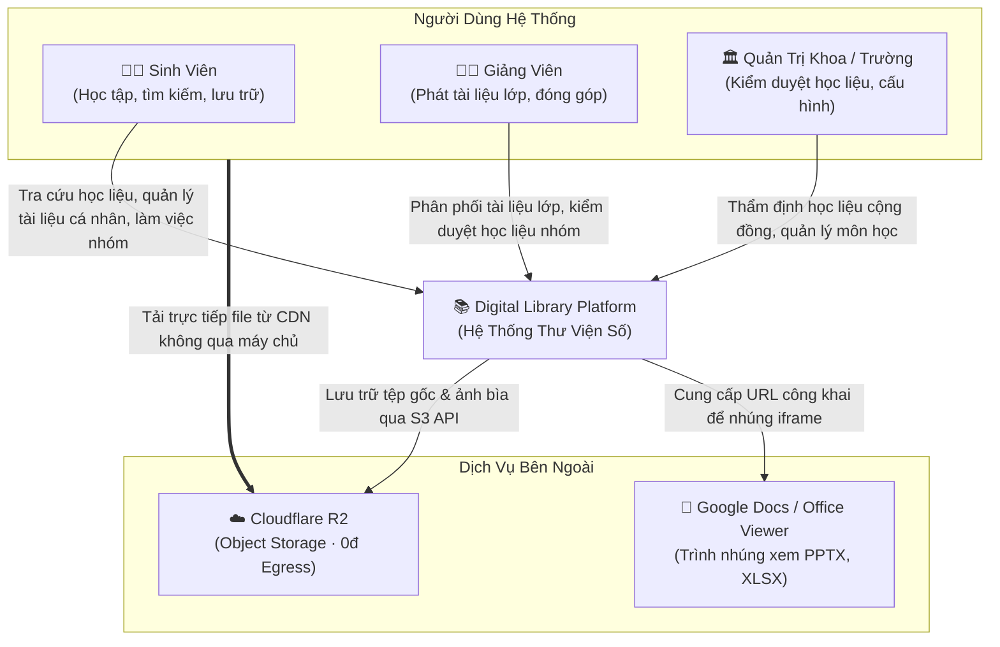
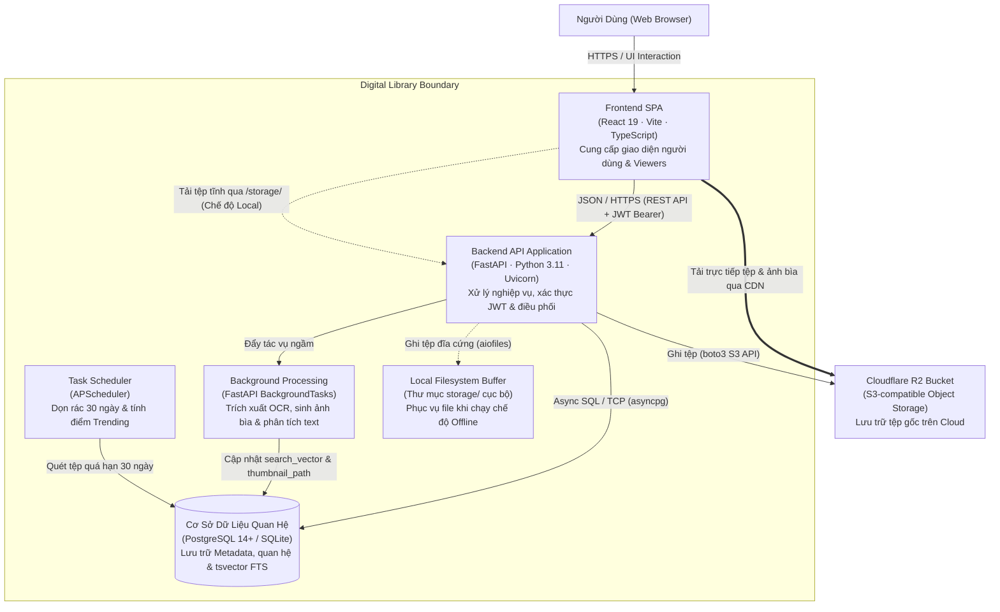
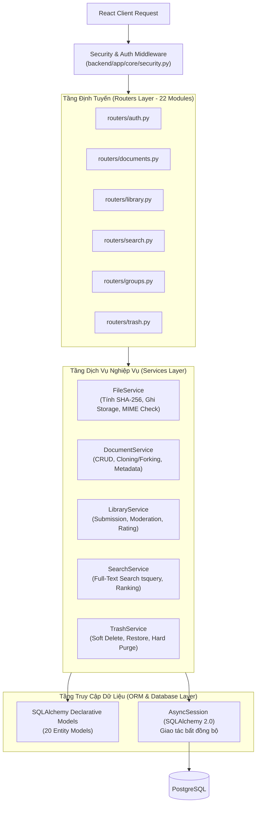

# 📐 Mô Hình Kiến Trúc C4 & Tổng Quan Hệ Thống

Để cung cấp góc nhìn đa chiều cho cả cấp quản lý lẫn kỹ sư phát triển, kiến trúc của **Digital Library Platform** được biểu diễn theo chuẩn mô hình **C4 Model** (Context, Containers, Components).

---

## 1. C4 Level 1: Sơ Đồ Ngữ Cảnh Hệ Thống (System Context Diagram)

Sơ đồ ngữ cảnh mô tả ranh giới của hệ thống Thư Viện Số đối với người dùng và các dịch vụ phụ trợ bên ngoài:

---

## 2. C4 Level 2: Sơ Đồ Các Thùng Chứa (Container Diagram)

Sơ đồ thùng chứa mô tả các khối phần mềm, công nghệ runtime và giao thức giao tiếp giữa chúng:

---

## 3. C4 Level 3: Sơ Đồ Thành Phần Máy Chủ (Backend Component Diagram)

Bên trong máy chủ **FastAPI Application**, mã nguồn được tổ chức theo cấu trúc phân tầng nghiêm ngặt nhằm đảm bảo tính đơn nhiệm và dễ kiểm thử:

---

## 4. Các Nguyên Tắc Thiết Kế Trọng Yếu (Design Principles)

1. **Phân tách hoàn toàn Giao diện và Dịch vụ (Decoupled Architecture):**
   * Frontend và Backend giao tiếp hoàn toàn qua giao thức RESTful JSON API chuẩn hóa. Frontend có thể deploy độc lập trên Cloudflare Pages/Vercel hoặc chạy chung cổng.
2. **Kiến trúc Không Trạng Thái (Stateless Application):**
   * Máy chủ FastAPI không lưu trữ thông tin phiên người dùng trong RAM bộ nhớ. Xác thực dựa trên mã thông báo JWT tự chứa (Self-contained JWT). Bất kỳ instance backend nào cũng có thể phục vụ bất kỳ request nào.
3. **Cơ chế Lưu trữ Lai Linh hoạt (Hybrid Storage Strategy):**
   * Tầng lưu trữ được trừu tượng hóa, tự động điều hướng sang S3 API (Cloudflare R2) khi có biến môi trường `R2_BUCKET_NAME`, hoặc rơi về Local Filesystem khi chạy ở chế độ cục bộ không mạng.
4. **Giảm tải Bộ vi xử lý bằng Client-Side Rendering (Edge Computing):**
   * Các tệp tin phức tạp (DOCX, PDF, Code) được phân tích cú pháp và dựng hình ngay tại trình duyệt của người dùng (nhờ các thư viện WebAssembly và Canvas), giảm thiểu hơn 90% tải CPU và RAM cho máy chủ Backend.
