# 🛠️ Ngăn Xếp Công Nghệ Chuẩn Hóa (Technology Stack)

Tài liệu này tổng hợp toàn bộ các công nghệ, framework, thư viện và công cụ được sử dụng trong dự án **Digital Library**, đối chiếu trực tiếp từ các tệp cấu hình thực tế (`backend/requirements.txt` và `frontend/digital-library/package.json`), kèm theo cơ sở lý luận lựa chọn và đánh đổi kỹ thuật.

---

## 1. Ngăn Xếp Tầng Máy Chủ (Backend Stack)

```mermaid
graph LR
    subgraph Core["Lõi Dịch Vụ"]
        Py["Python 3.11+"]
        FastAPI["FastAPI 0.111.0"]
        Uvicorn["Uvicorn 0.30.1 (uvloop)"]
    end

    subgraph Data["Dữ Liệu & ORM"]
        SQLA["SQLAlchemy 2.0.31 (Async)"]
        AsyncPG["asyncpg 0.29.0"]
        Alembic["Alembic 1.16.5"]
        Pydantic["Pydantic V2 2.7.4"]
    end

    subgraph Infra["Hạ Tầng & Tác Vụ"]
        Boto3["boto3 1.43.112 (S3/R2)"]
        APSch["APScheduler 3.11.3"]
        JWT["PyJWT 2.10.1 & bcrypt"]
        Tess["pytesseract 0.3.13 & pdfplumber"]
    end

    Core --> Data
    Data --> Infra
```

| Thành phần | Công nghệ / Thư viện | Phiên bản | Lý do lựa chọn & Lợi ích kỹ thuật | Đánh đổi kỹ thuật (Trade-offs) |
|---|---|:---:|---|---|
| **Ngôn ngữ** | **Python** | `3.11+` | Hiệu năng xử lý nhanh hơn 25-60% so với 3.10; hệ sinh thái thư viện xử lý tài liệu (PDF, Word, OCR) phong phú nhất thế giới. | Tốc độ xử lý thô CPU-bound chậm hơn Go/Rust. |
| **Framework** | **FastAPI** | `0.111.0` | Hỗ trợ Asynchronous tự nhiên (`async/await`), tự động sinh tài liệu Swagger UI, hiệu năng tiệm cận NodeJS và Go. | Đòi hỏi lập trình viên phải nắm vững lập trình bất đồng bộ. |
| **ASGI Server** | **Uvicorn + uvloop** | `0.30.1` | Event loop viết bằng C (uvloop), cung cấp thông lượng I/O cực cao cho các tác vụ truyền file. | Yêu cầu môi trường tương thích POSIX/Linux. |
| **ORM & Database** | **SQLAlchemy** | `2.0.31` | Chuẩn ORM số 1 của Python; hỗ trợ `AsyncSession` bất đồng bộ hoàn toàn với driver `asyncpg`. | Cú pháp phiên bản 2.0 chặt chẽ, đường cong học tập cao hơn 1.4. |
| **Database Driver** | **asyncpg** | `0.29.0` | Driver kết nối PostgreSQL nhanh nhất trong hệ sinh thái Python, tối ưu hóa giao tiếp TCP nhị phân. | Không tương thích trực tiếp với các câu lệnh đồng bộ (sync). |
| **Data Validation** | **Pydantic V2** | `2.7.4` | Phần core viết bằng Rust giúp serialize/deserialize dữ liệu nhanh gấp 5-10 lần Pydantic v1. | Một số thay đổi cú pháp đột phá so với phiên bản V1. |
| **Database Migration** | **Alembic** | `1.16.5` | Quản lý lịch sử thay đổi cấu trúc bảng cơ sở dữ liệu có phiên bản, hỗ trợ rollback an toàn. | Cần cấu hình bổ sung khi chạy ở chế độ Async Engine. |
| **Cloud Storage** | **boto3** | `1.43.112` | SDK S3 tiêu chuẩn công nghiệp của AWS, tương thích 100% với giao thức Object Storage của Cloudflare R2. | Kích thước gói thư viện tương đối nặng. |
| **Job Scheduling** | **APScheduler** | `3.11.3` | Lập lịch tác vụ định kỳ trong tiến trình (In-process cron jobs) cho dọn rác 30 ngày và suy hao điểm trending. | Chạy đơn tiến trình; khi mở rộng multi-instance cần chuyển Redis. |
| **Trích xuất Text & OCR** | **pytesseract & pdfplumber** | `0.3.13` | Trích xuất văn bản từ tệp PDF và nhận diện chữ tiếng Việt từ ảnh scan phục vụ tìm kiếm toàn văn FTS. | Tiêu tốn tài nguyên CPU khi xử lý tệp scan có độ phân giải cao. |

---

## 2. Ngăn Xếp Tầng Khách Hàng (Frontend Stack)

```mermaid
graph LR
    subgraph CoreFE["Lõi Giao Diện"]
        React["React 19.2.8"]
        Vite["Vite 8.2.2"]
        TS["TypeScript ~6.0.2"]
    end

    subgraph StateUI["Giao Diện & Dữ Liệu"]
        Tailwind["Tailwind CSS v4.3.3"]
        Query["TanStack Query v5.102.8"]
        Zustand["Zustand 5.0.15"]
        Router["React Router v7.18.3"]
    end

    subgraph Viewers["Trình Xem Tài Liệu"]
        Docx["docx-preview 0.4.1"]
        Shiki["shiki 4.5.0 (Syntax Highlighting)"]
        MD["react-markdown 10.1.0"]
        Chart["recharts 3.10.1"]
    end

    CoreFE --> StateUI
    StateUI --> Viewers
```

| Thành phần | Thư viện | Phiên bản | Lý do lựa chọn & Lợi ích kỹ thuật | Đánh đổi kỹ thuật (Trade-offs) |
|---|---|:---:|---|---|
| **Thư viện UI Lõi** | **React** | `19.2.8` | Hỗ trợ các tính năng đồng thời (Concurrent Features), Server Actions và tối ưu hóa chu kỳ render. | Phiên bản mới cần kiểm tra tương thích với một số thư viện cũ. |
| **Build Tool** | **Vite** | `8.2.2` | Tốc độ biên dịch Hot Module Replacement (HMR) tức thì dưới 50ms nhờ kiến trúc Native ESM và Esbuild. | Cấu hình plugin SSR phức tạp hơn Next.js. |
| **Ngôn ngữ** | **TypeScript** | `~6.0.2` | Kiểm soát chặt chẽ kiểu dữ liệu từ API (`types/`), giảm thiểu 95% lỗi runtime undefined. | Tăng thời gian viết code ban đầu để định nghĩa interface. |
| **Styling Framework** | **Tailwind CSS v4** | `4.3.3` | Động cơ Oxide viết bằng Rust, cấu hình trực tiếp qua CSS không cần file `tailwind.config.js`. | Lớp giao diện mới cần thời gian làm quen với Tailwind 4 engine. |
| **Server State Cache** | **TanStack React Query** | `5.102.8` | Quản lý bộ nhớ đệm dữ liệu từ máy chủ (caching, invalidation, optimistic updates, background refetch). | Cần phân biệt rõ Server State (Query) và Client State (Zustand). |
| **Client State Store** | **Zustand** | `5.0.15` | Quản trị trạng thái cục bộ cực nhẹ (< 1KB), cú pháp đơn giản, không cần bọc Provider rườm rà như Redux. | Ít middleware phức tạp dựng sẵn so với Redux Toolkit. |
| **Routing** | **React Router** | `7.18.3` | Chuẩn điều hướng trang đơn (SPA) số 1 của hệ sinh thái React. | Phiên bản v7 gộp nhiều khái niệm từ Remix. |
| **DOCX Viewer** | **docx-preview** | `0.4.1` | Dựng trực tiếp file Word sang thẻ HTML tại trình duyệt, không cần máy chủ chuyển đổi file. | Khả năng dựng hình một số bảng biểu phức tạp có thể lệch nhẹ. |
| **Code Syntax Highlighting** | **Shiki** | `4.5.0` | Bộ tô màu cú pháp dùng TextMate Grammars chuẩn VS Code, hiển thị màu sắc code cực kỳ chuẩn xác. | Kích thước bundle ngôn ngữ khá lớn nếu không nạp lười (lazy load). |
| **Linter Siêu Tốc** | **Oxlint** | `1.79.0` | Bộ kiểm tra lỗi viết bằng Rust, chạy nhanh hơn ESLint từ 50 đến 100 lần trong quá trình phát triển. | Hệ sinh thái plugin chưa phong phú bằng ESLint truyền thống. |

---

## 3. Hạ Tầng Dữ Liệu & Lưu Trữ (Data & Storage Stack)

* **Hệ Quản Trị Cơ Sở Dữ Liệu:** **PostgreSQL 14 / 15 / 16**
  * *Lý do:* Khả năng mở rộng mạnh mẽ, hỗ trợ kiểu dữ liệu nhị phân `JSONB`, bộ lập chỉ mục chuyên dụng cho tìm kiếm toàn văn (`tsvector`, `tsquery`), và phần mở rộng tính độ tương đồng xâu ký tự `pg_trgm`.
* **Hạ Tầng Lưu Trữ Đối Tượng Đám Mây:** **Cloudflare R2 Object Storage**
  * *Lý do:* Tương thích hoàn toàn chuẩn giao thức **Amazon S3 API**; đặc biệt có chính sách **0đ phí truyền dữ liệu ra ngoài (Zero Egress Fees)**, giúp nhà trường loại bỏ hoàn toàn chi phí phát sinh khi hàng ngàn sinh viên tải tài liệu ôn tập.
* **Hạ Tầng Lưu Trữ Cục Bộ (Fallback):** **Local Filesystem Buffer (`backend/storage/`)**
  * *Lý do:* Cho phép hệ thống tự động rơi về chế độ lưu trữ cục bộ khi mất mạng hoặc khi developer chạy đồ án ở chế độ Offline 100%.

---

## 4. Công Cụ Tài Liệu & Tự Động Hóa (DevOps & Documentation)

* **Documentation Platform:** **Docusaurus 3.10.2** (React 19, `@docusaurus/preset-classic`, `@docusaurus/theme-mermaid`).
* **Hosting & CDN Tài Liệu:** **GitHub Pages** (triển khai tự động từ nhánh `gh-pages`).
* **CI/CD Pipeline:** **GitHub Actions** (Workflow [.github/workflows/deploy-docs.yml](file:///Users/caotiendattx/Developer/Do_An_Co_So/Foundation-Project/.github/workflows/deploy-docs.yml) tự động build và deploy khi có commit mới vào nhánh `main`).
* **Phân Tích Đồ Thị Tri Thức:** **Graphify Engine** (Theo dõi cây phụ thuộc mã nguồn AST-only với 3.397 nodes và 8.765 edges).
