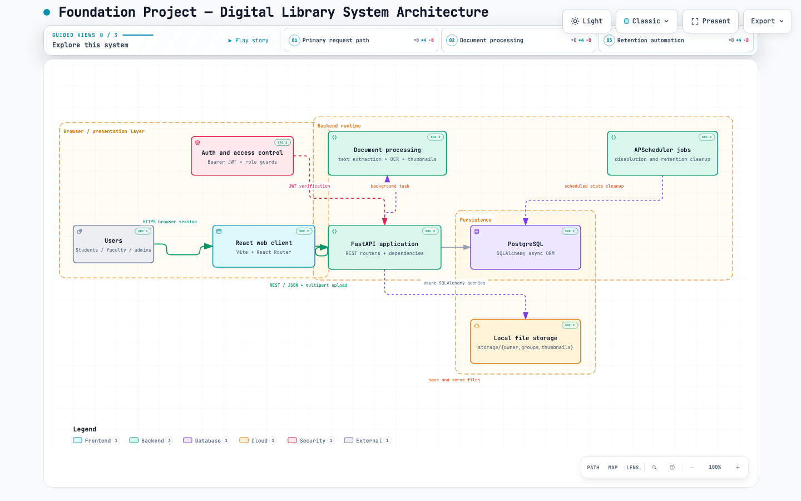
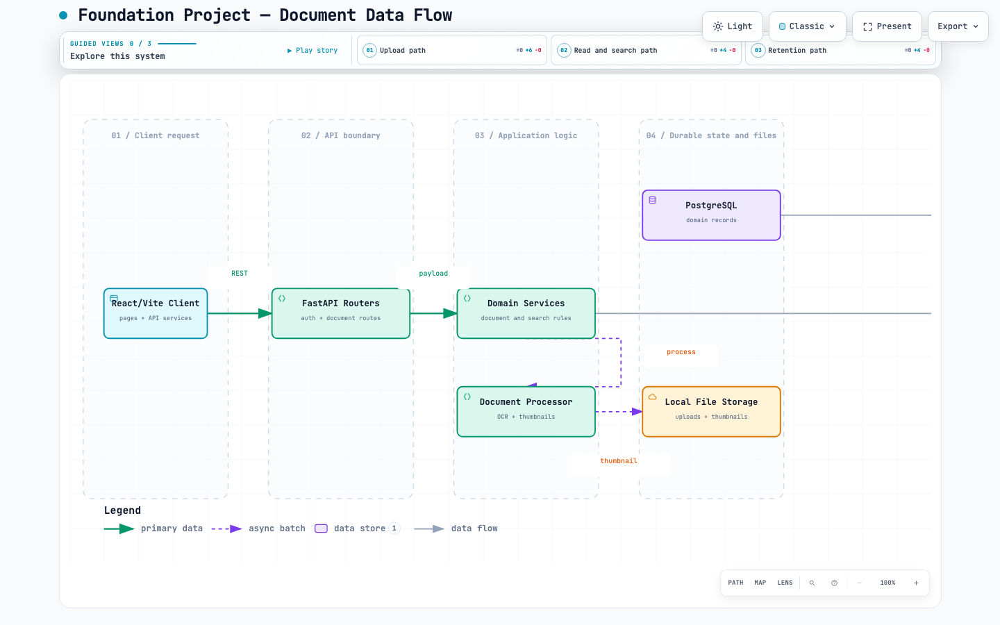

# Kiến Trúc Hệ Thống

Tổng quan kiến trúc tổng thể và luồng dữ liệu của hệ thống **Digital Library (Thư Viện Số)**.

---

## Sơ Đồ Kiến Trúc Tổng Thể

> Hệ thống sử dụng mô hình **Hybrid Cloud Storage Architecture** kết hợp Cloudflare R2, FastAPI Backend và React Frontend.

---

## Luồng Dữ Liệu (Data Flow)

> Mô tả luồng dữ liệu từ upload tài liệu, xử lý OCR/Thumbnail đến khi hiển thị cho người dùng.

---

## Tài Liệu Liên Quan

- [Hệ Thống Lưu Trữ (Storage System)](../architecture/STORAGE_SYSTEM) — Chi tiết về Storage architecture
- [Deployment & Storage R2](../deployment/STORAGE_R2) — Cấu hình Cloudflare R2
- [Biến Môi Trường](../deployment/ENV_VARIABLES) — Danh sách environment variables
