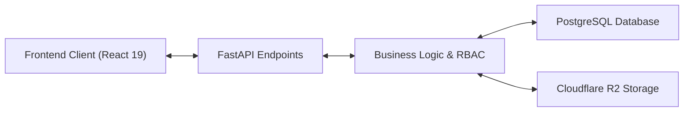

# Khung Mẫu Đặc Tả Tính Năng Mới (Feature Specification Template)

> 💡 **Hướng dẫn sử dụng**: Sao chép mẫu này khi phát triển một phân hệ tính năng mới. Lưu file vào thư mục `docs/feat/ten-tinh-nang-moi/README.md` (hoặc các file con tương ứng `API.md`, `BUSINESS_RULES.md`, `DATABASE.md`, `FRONTEND.md`). **Không** dùng file này để ghi đè các tài liệu tính năng hiện có trong `docs/feat/`.

---

## 1. Tổng Quan & Mục Tiêu Nghiệp Vụ

### 1.1. Bối Cảnh & Động Lực Phát Triển
*Mô tả lý do vì sao tính năng này cần thiết, người dùng gặp khó khăn gì và giá trị mang lại cho hệ sinh thái thư viện số.*

### 1.2. Đối Tượng Sử Dụng & Vai Trò Cho Phép
- **Vai trò chính**: `student` | `teacher` | `faculty_admin` | `school_admin` | `system_admin`
- **Mức độ truy cập**: Cá nhân / Nhóm / Thư viện công cộng

---

## 2. Kiến Trúc Kỹ Thuật



---

## 3. Đặc Tả Giao Diện (Frontend Specifications)

### 3.1. Danh Sách Components Cốt Lõi
- `FeatureMainContainer.tsx`: Khung điều hướng chính.
- `FeatureItemCard.tsx`: Hiển thị chi tiết từng bản ghi.
- `FeatureActionModal.tsx`: Hộp thoại tương tác.

### 3.2. Quản Lý Trạng Thái (State Management)
- **Client Cache**: TanStack React Query `useQuery`, `useMutation` kèm `queryKey: ['feature_name']`.
- **Global UI State**: Zustand store (nếu cần quản lý modal/chế độ hiển thị).

---

## 4. Đặc Tả RESTful API (API Specifications)

| Phương thức | Đường dẫn (Path) | Quyền hạn yêu cầu | Ý nghĩa nghiệp vụ | Mã phản hồi |
| :--- | :--- | :--- | :--- | :--- |
| `GET` | `/api/feature/` | Bearer Token | Lấy danh sách bản ghi | `200 OK` |
| `POST` | `/api/feature/` | Bearer Token | Tạo mới bản ghi | `201 Created` |
| `PATCH` | `/api/feature/{id}` | Owner / Admin | Cập nhật bản ghi | `200 OK` |
| `DELETE` | `/api/feature/{id}` | Owner / Admin | Xóa mềm bản ghi | `204 No Content` |

---

## 5. Mô Hình Dữ Liệu (Database Schema)

### 5.1. Bảng Dữ Liệu Mới (Hoặc Cột Mới Cần Thêm)
```sql
CREATE TABLE IF NOT EXISTS example_features (
    id SERIAL PRIMARY KEY,
    owner_id INTEGER NOT NULL REFERENCES users(id) ON DELETE CASCADE,
    title VARCHAR(255) NOT NULL,
    status VARCHAR(30) NOT NULL DEFAULT 'active',
    created_at TIMESTAMPTZ NOT NULL DEFAULT now(),
    updated_at TIMESTAMPTZ NOT NULL DEFAULT now()
);

CREATE INDEX IF NOT EXISTS idx_example_features_owner ON example_features(owner_id);
```

---

## 6. Quy Tắc Nghiệp Vụ & Ràng Buộc (Business Rules)

1. **BR-01**: Mô tả điều kiện tiên quyết trước khi thực hiện hành động.
2. **BR-02**: Ràng buộc toàn vẹn dữ liệu (VD: Không được phép trùng tên trong cùng một thư mục).
3. **BR-03**: Xử lý tình huống biên (Edge cases, timeout, mất mạng).

---

## 7. Kế Hoạch Kiểm Thử & Đảm Bảo Chất Lượng

- [ ] Unit Test cho Router tại `backend/tests/test_feature_name.py`.
- [ ] Kiểm tra phân quyền RBAC và mã lỗi (401, 403, 404, 422).
- [ ] Kiểm tra kiểu dữ liệu TypeScript phía frontend (`npm run build`).
- [ ] Kiểm tra định dạng linting (`npm run lint`).
