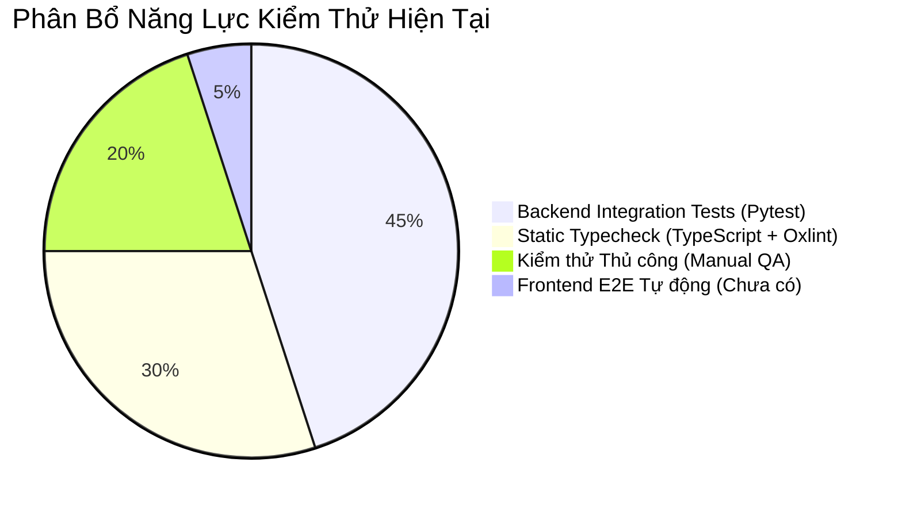
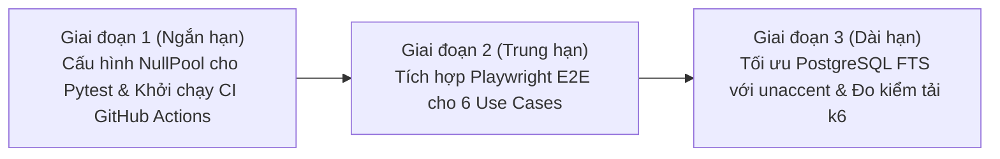

# Hiện Trạng Chất Lượng & Giới Hạn Đã Biết (Quality & Known Limitations)

Tài liệu này cung cấp báo cáo đánh giá trung thực, khách quan về độ bao phủ kiểm thử, các khoảng trống kỹ thuật (Testing Gaps), các giới hạn đã biết (Known Limitations) và lộ trình nâng cao chất lượng phần mềm của **Foundation Project**.

---

## 1. Đánh Giá Hiện Trạng Bao Phủ Kiểm Thử (Coverage Assessment)

### 1.1. Các Phân Hệ Được Kiểm Thử Tốt (High Coverage & Stable)
- **Xác thực & Quản lý phiên (`test_auth.py`)**: Đăng ký, đăng nhập băm mật khẩu `bcrypt`, ký token JWT và phân quyền người dùng.
- **Khử trùng lặp lưu trữ (`test_storage_dedup.py`)**: Tính toán mã băm SHA-256, tái sử dụng khối lưu trữ và phân quyền cách ly sở hữu.
- **Chia sẻ tài liệu & Phân cấp RBAC (`test_shares.py`)**: Quy tắc tự động duyệt dựa trên thứ bậc vai trò (`role_rank`), cơ chế ngăn chặn trùng lặp bằng Partial Unique Index.
- **Thống kê Dashboard (`test_dashboard.py`, `test_activity_sorting.py`)**: Đếm tài liệu, tính dung lượng, sắp xếp dòng hoạt động theo thời gian thực.
- **Đếm tài liệu thư viện (`test_library_counts.py`)**: Loại trừ tài liệu xóa mềm và tài liệu riêng tư khỏi bộ đếm công khai của Khoa và Môn học.

### 1.2. Các Khoảng Trống Kiểm Thử (Testing Gaps)

| Khoảng trống | Mô tả chi tiết | Tác động rủi ro | Giải pháp khắc phục |
| :--- | :--- | :--- | :--- |
| **Frontend E2E Automation** | Chưa cài đặt các framework kiểm thử giao diện đầu cuối tự động (như Playwright hoặc Cypress). | Rủi ro hồi quy (Regression) trên giao diện người dùng khi cập nhật component React. | Bổ sung bộ kịch bản Playwright kiểm thử 6 luồng Use Case cốt lõi. |
| **Kiểm Thử Chịu Tải (Load/Stress Testing)** | Chưa có kịch bản đo kiểm hiệu năng chịu tải đồng thời (như k6 hoặc Locust) cho các tác vụ tải file lớn. | Chưa xác định chính xác ngưỡng chịu tải tối đa của server trước khi nghẽn mạng. | Xây dựng bộ test k6 mô phỏng 500 sinh viên đồng thời truy cập tra cứu mùa thi. |
| **Mô Phỏng Lỗi Cloudflare R2** | Trong môi trường test cục bộ, hệ thống ghi file ra thư mục đĩa `storage/`. | Chưa bao phủ các trường hợp Cloudflare R2 trả về mã lỗi 429 Rate Limit hoặc mất mạng S3. | Bổ sung fixture mock `boto3.client("s3")` với các kịch bản ném ngoại lệ mạng. |

---

## 2. Các Giới Hạn Đã Biết (Known Limitations)

### 2.1. Phụ Thuộc Vào Tính Năng Bản Địa Của PostgreSQL
- **Mô tả**: Tính năng tìm kiếm toàn văn FTS sử dụng kiểu dữ liệu `tsvector` và trigger `tsvector_update_trigger`.
- **Hệ quả**: Không thể sử dụng SQLite in-memory để chạy test nhanh gọn. Toàn bộ môi trường phát triển và kiểm thử bắt buộc phải có một máy chủ PostgreSQL thật đang hoạt động.

### 2.2. Xử Lý Tách Từ Tiếng Việt Trong Full-Text Search
- **Mô tả**: PostgreSQL hiện đang dùng từ điển mặc định `pg_catalog.english`.
- **Hệ quả**: Các từ tiếng Việt có dấu sẽ được tìm kiếm theo phương pháp so khớp chuỗi chuẩn xác (`plainto_tsquery`), chưa hỗ trợ tự động tìm kiếm không dấu (Accent-insensitive stemming) nếu chưa cài extension `unaccent`.

### 2.3. Tái Sử Dụng Connection Pool Trong Phiên Pytest Đơn Lẻ
- **Mô tả**: Khi chạy tất cả 22 bài test bằng một lệnh `pytest backend/tests/`, SQLAlchemy giữ lại một số kết nối `asyncpg` đang mở giữa các event loop khác nhau, phát sinh warning `Connection._cancel was never awaited`.
- **Hệ quả**: Một số test case yêu cầu mở transaction mới có thể bị từ chối nếu không được cô lập riêng.

### 2.4. Phụ Thuộc Vào Tiến Trình APScheduler Trong Quá Trình Dọn Rác
- **Mô tả**: Việc dọn dẹp vĩnh viễn (Purge) tài liệu trong thùng rác sau 30 ngày do APScheduler kích hoạt định kỳ.
- **Hệ quả**: Nếu server bị tắt trong thời gian dài, các tài liệu quá hạn sẽ không được dọn dẹp cho đến khi server được khởi động lại và chạy hàm startup.

---

## 3. Lộ Trình Nâng Cao Chất Lượng (Quality Roadmap)

1. **Ngắn hạn (1-2 tuần)**:
   - Cập nhật `conftest.py` với cấu hình `NullPool` nhằm triệt tiêu hoàn toàn warning kết nối asyncpg.
   - Thiết lập GitHub Actions workflow tự động chạy `oxlint`, `tsc -b`, `pytest` và `docusaurus build` trên mọi Pull Request.
2. **Trung hạn (1 tháng)**:
   - Viết bộ test Playwright kiểm thử tự động giao diện đăng nhập, tải tài liệu và xem trước file Word/PDF.
3. **Dài hạn (3 tháng)**:
   - Nâng cấp tìm kiếm Tiếng Việt với extension `unaccent`.
   - Thiết lập kịch bản benchmark k6 để xác định tải trần của hệ thống trên môi trường Cloud VPS.
