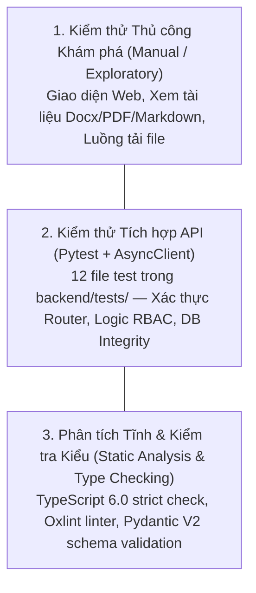

# Chiến Lược & Phương Pháp Kiểm Thử (Testing Strategy)

Tài liệu này đặc tả kiến trúc kiểm thử, mô hình kim tự tháp chất lượng và các kỹ thuật kiểm thử bất đồng bộ chuyên sâu được áp dụng trong **Foundation Project**.

---

## 1. Kim Tự Tháp Kiểm Thử Trong Dự Án (Testing Pyramid)



1. **Tầng 1 — Phân tích tĩnh (Static Analysis)**:
   - **TypeScript Compiler (`tsc -b`)**: Bắt lỗi kiểu dữ liệu sai lệch giữa frontend interfaces và backend DTOs ngay trong giai đoạn build.
   - **Oxlint**: Quét mã nguồn frontend bằng engine Rust siêu tốc để phát hiện các lỗi logic JavaScript/React phổ biến (unclosed resources, dead code, hook rules).
   - **Pydantic V2**: Tự động chặn và phản hồi lỗi `422 Unprocessable Entity` ngay tại cổng vào của API nếu payload không đúng định dạng.
2. **Tầng 2 — Kiểm thử tích hợp API (Integration Tests)**:
   - Chạy toàn bộ các kịch bản tương tác với router bằng `httpx.AsyncClient` kết nối tới cơ sở dữ liệu thật.
   - Xác thực các ràng buộc toàn vẹn dữ liệu, các nghiệp vụ phức tạp (deduplication, phân cấp quyền hạn, tính toán trending score).
3. **Tầng 3 — Kiểm thử thủ công có hệ thống (Exploratory Testing)**:
   - Đội ngũ phát triển và kiểm thử kiểm tra các trải nghiệm người dùng thực tế: thao tác kéo thả tệp, xem trước file Word `.docx` và file PDF phức tạp, hiển thị Markdown với Shiki syntax highlighting.

---

## 2. Kỹ Thuật Kiểm Thử Bất Đồng Bộ (Async Testing Patterns)

Kiến trúc kiểm thử của backend được thiết lập tập trung tại file `backend/tests/conftest.py`:

### 2.1. Thiết lập HTTP Client Bất đồng bộ (`httpx.AsyncClient`)
Mô phỏng các cuộc gọi HTTP thực tế tới ứng dụng FastAPI mà không cần phải khởi chạy web server thật trên cổng mạng:
```python
import pytest
from httpx import AsyncClient, ASGITransport
from app.main import app

@pytest.fixture
async def client():
    transport = ASGITransport(app=app)
    async with AsyncClient(transport=transport, base_url="http://test") as ac:
        yield ac
```

### 2.2. Kiểm Thử Phân Bản & Chống Trùng Lặp Lưu Trữ (Deduplication Testing)
Được kiểm chứng tại `backend/tests/test_storage_dedup.py`:
- Kịch bản 1: Hai người dùng khác nhau tải lên cùng một file nhị phân có cùng mã băm SHA-256.
- Kết quả kỳ vọng:
  - Hệ thống tạo 2 bản ghi `Document` khác nhau trong cơ sở dữ liệu để bảo đảm quyền sở hữu riêng biệt.
  - Cả hai bản ghi đều trỏ tới cùng một đường dẫn `file_path` trên đĩa / Cloudflare R2.
  - Dung lượng lưu trữ thực tế trên hạ tầng chỉ tốn 1 lần dung lượng file.

### 2.3. Kiểm Thử Phân Quyền Chia Sẻ Tự Động (Auto-Accept RBAC Testing)
Được kiểm chứng tại `backend/tests/test_shares.py`:
- Kịch bản 1 (Thứ bậc cao -> thấp): Giảng viên (`teacher`, rank=2) chia sẻ tài liệu cho Sinh viên (`student`, rank=1).
  - Kết quả kỳ vọng: Trạng thái chia sẻ lập tức là `accepted`, tài liệu xuất hiện trong kho sinh viên ngay lập tức.
- Kịch bản 2 (Thứ bậc thấp -> cao): Sinh viên chia sẻ cho Giảng viên.
  - Kết quả kỳ vọng: Trạng thái chia sẻ là `pending`, chờ giảng viên bấm phê duyệt qua endpoint `/shares/{id}/accept`.

### 2.4. Kiểm Thử Bộ Đếm & Cách Ly Xóa Mềm (Counting & Soft-Delete Testing)
Được kiểm chứng tại `backend/tests/test_library_counts.py`:
- Kiểm tra hàm đếm số lượng tài liệu theo Khoa và Môn học.
- Đảm bảo các tài liệu đã bị xóa mềm (`is_deleted = true`), tài liệu cá nhân chưa xuất bản (`is_public = false`), hoặc tài liệu chưa được duyệt (`status != 'approved'`) hoàn toàn không được tính vào số lượng hiển thị trên trang chủ thư viện.
